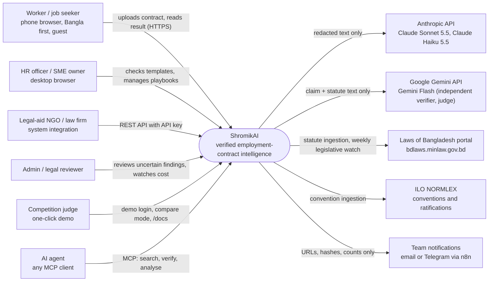
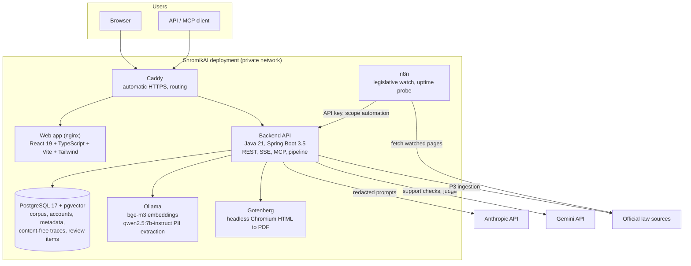
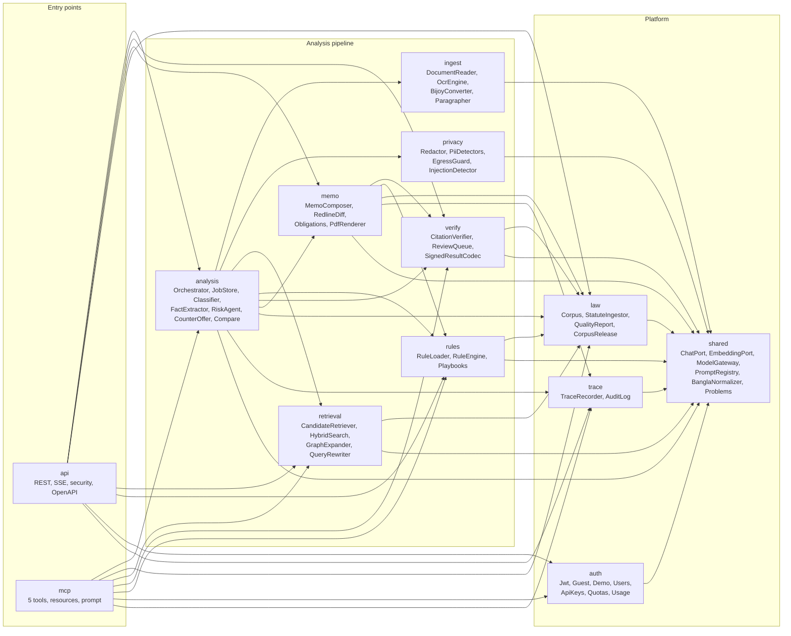
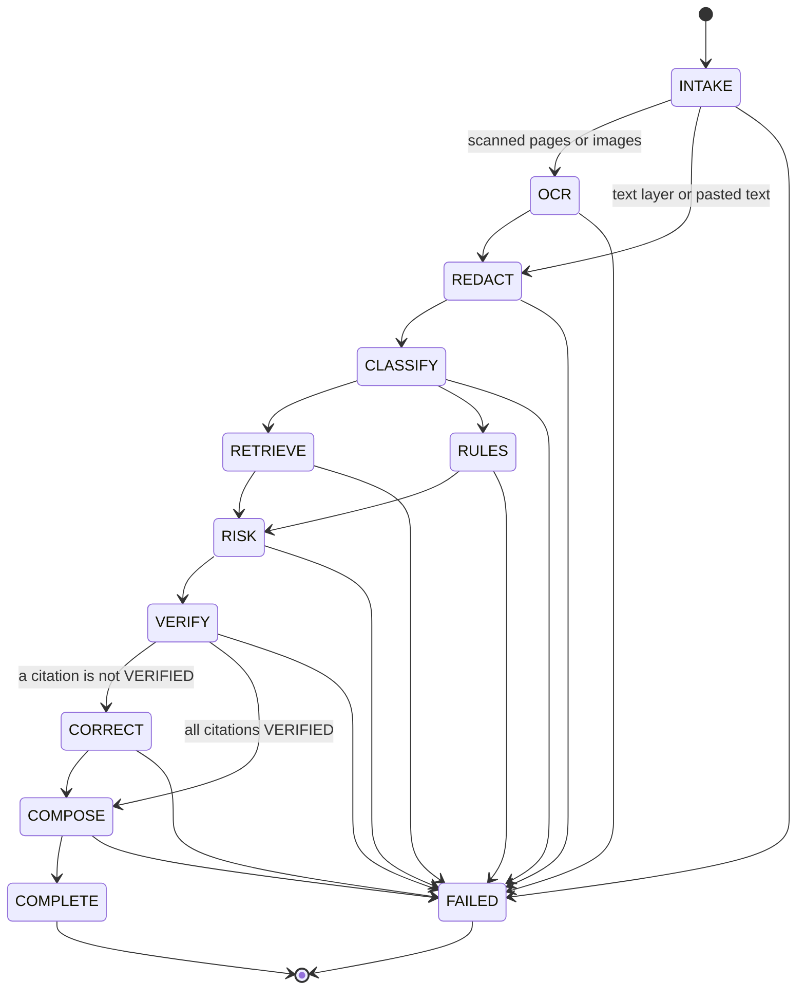
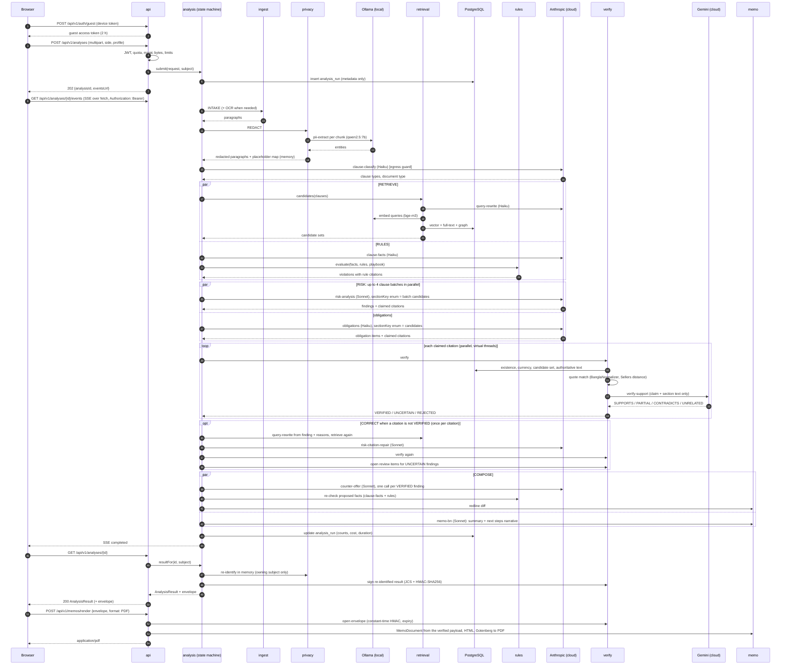
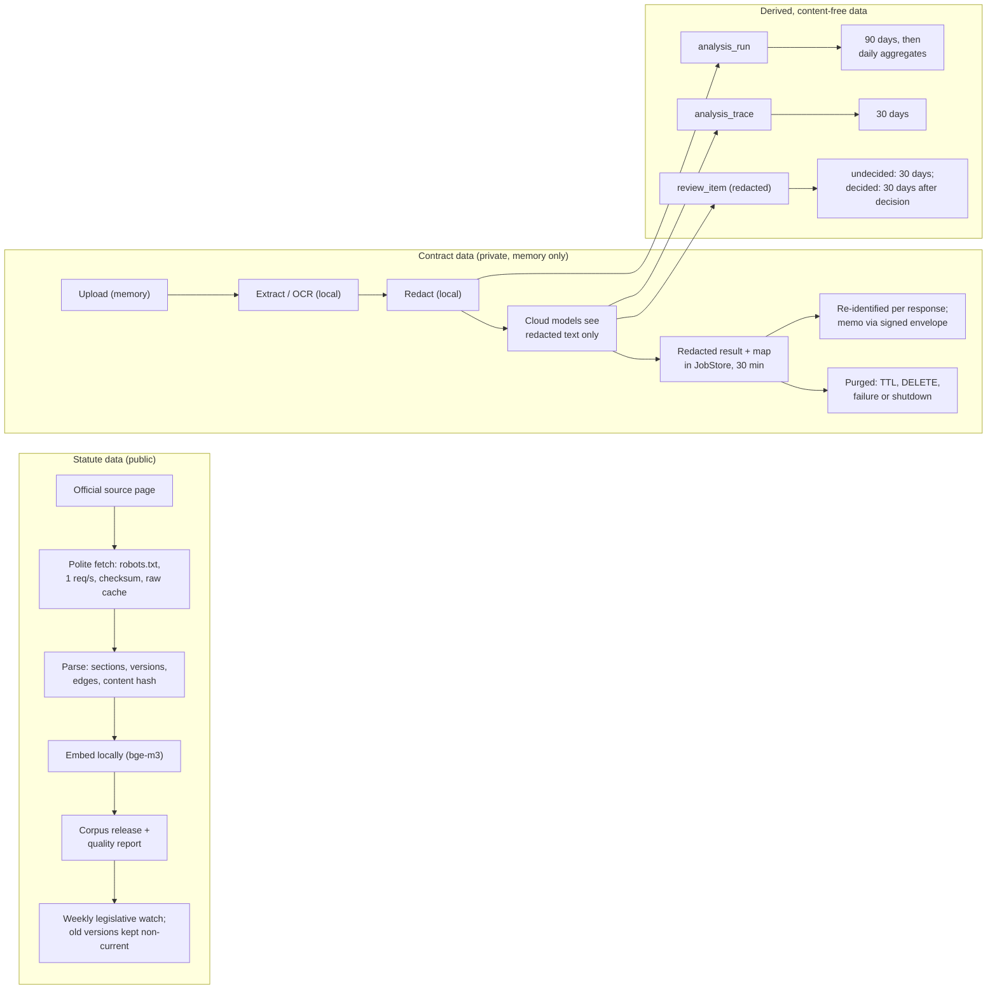

# ShromikAI: Architecture Specification

| Field | Value |
| --- | --- |
| Spec version | v1.1 (tag `spec-v1.1`), aligned with the master prompt playbook v1.2 |
| Binding rules | [`AGENTS.md`](../../AGENTS.md) (rules R-01 to R-12, module map) |
| Requirements | [`PRD.md`](PRD.md) (FR, NFR, KPI IDs) |
| Interfaces | [`api.md`](api.md) |
| Decisions | [`docs/adr/0001`](../adr/0001-stack.md) to [`0008`](../adr/0008-latency-and-cost-budget.md) |

No statute text, section number or numeric legal limit appears in this document. Wherever the
architecture depends on one, the value is "derived from the ingested statute in P3" and lives in
the corpus or in reviewed YAML under `data/`, never in code.

---

## 1. Architectural principles

1. **Verification is a gate, not a feature.** A citation becomes visible only after it passes three independent checks (§7). Only `bd.shromikai.verify` can create a `VerifiedCitation`.
2. **The model can only cite what retrieval found.** The risk agent's output schema restricts `sectionKey` to an `enum` of retrieved candidates, and the existence check rejects anything outside the candidate set (§7, §8).
3. **Deterministic where possible, LLM where necessary.** Numeric limits are checked by the rule engine (§9); LLMs extract typed facts and reason about meaning.
4. **Local first.** OCR, PII detection and embeddings run on the deployment's own hardware. Cloud models see only redacted text (§10).
5. **Content-free persistence.** The database stores the corpus, accounts, metadata, content-free traces and redacted review items; never contract text (R-02).
6. **Explicit abstention.** "Uncertain" is a first-class result with a review path.
7. **One database.** PostgreSQL 17 serves relational data, vectors, full-text search and the knowledge graph (ADR-0004).
8. **Ports and adapters for models.** `ChatPort` and `EmbeddingPort` hide providers; `ModelGateway` adds prompts, validation, egress checks and cost accounting (ADR-0005).
9. **An explicit state machine.** The analysis is a sequence of named states with a trace event per transition (§5).

## 2. System context (C4 level 1)



## 3. Containers (C4 level 2)



| Container | Technology | Responsibility | Stores contract text? |
| --- | --- | --- | --- |
| Caddy | Caddy 2 | TLS termination, routing of `/`, `/api`, `/mcp`, `/swagger-ui`, `/actuator/health` | No (request bodies never logged) |
| Web app | React 19, TS, Vite, Tailwind, served by nginx | Journeys J1 to J5, `/docs` hub; client-side image compression; SSE client | No (results only in component memory) |
| Backend API | Spring Boot 3.5 on Java 21 virtual threads | All modules in `AGENTS.md` §4 | In JVM memory only, ≤ 30 minutes after completion |
| PostgreSQL | `pgvector/pgvector:pg17` | Data model in §11 | No |
| Ollama | `ollama/ollama` pinned tag, GPU | Local embeddings and PII extraction | No (`OLLAMA_DEBUG` unset, so prompts are not logged; the volume holds model weights only) |
| Gotenberg | `gotenberg/gotenberg` pinned tag | Memo HTML to PDF; no outbound network | No (`tmpfs` for `/tmp`; request-scoped files only) |
| n8n | `n8nio/n8n` pinned tag, basic auth | `legislative-watch` and `uptime-probe` workflows | No (payloads carry URLs, hashes, counts and IDs) |

## 4. Components (C4 level 3: backend modules)



Key interfaces (binding from P1 onwards):

| Interface | Module | Signature (Java) | Notes |
| --- | --- | --- | --- |
| `ChatPort` | shared.ai | `ChatResponse call(ChatRequest request)` | Provider-level call: messages, JSON Schema for structured output, effort or temperature, max tokens, timeout. Adapters: `AnthropicChatAdapter` (Anthropic Java SDK), `GeminiChatAdapter` (`RestClient`), `OllamaChatAdapter` (Spring AI). Cloud adapters call `EgressGuard` first |
| `EmbeddingPort` | shared.ai | `List<float[]> embed(List<String> texts)` | `OllamaEmbeddingAdapter` (Spring AI, bge-m3) |
| `ModelGateway` | shared.ai | `<T> ModelResult<T> call(PromptRef prompt, Map<String,Object> vars, Class<T> type, CallContext ctx)` | Renders the prompt, resolves the role's model from `shromikai.models.*`, calls `ChatPort`, validates against the schema, one repair on invalid output, reports usage to `LlmCallListener` for the cost ledger |
| `EgressGuard` | shared.ai (port), privacy (impl) | `void check(String outboundPayload, CallContext ctx) throws EgressBlockedException` | Startup fails if no bean implements it |
| `PromptRegistry` | shared.ai | `PromptTemplate get(String id, int version)` | Loads and lint-checks `prompts/` at startup |
| `BanglaNormalizer` | shared | `String forMatching(String text)` | §7.2; display text is never changed |
| `QuoteMatcher` | shared (`shared.text`) | `QuoteMatch match(String quote, String authoritativeText)` | §7.3 check (b) algorithm; used by `verify` (citations, review decisions), `rules` (`RuleLoader`) and `law` (ILO mapping loader, §7.8); 80 % coverage gate |
| `CanonicalJson` | shared | `byte[] canonicalise(JsonNode value)` | RFC 8785 (JCS); checked against the RFC test vectors |
| `DocumentReader` | ingest | `ExtractedDocument read(Upload upload, CancellationToken token)` | Paragraphs, languages, page map, OCR confidences |
| `Redactor` | privacy | `RedactionResult redact(ExtractedDocument doc)` | Redacted paragraphs and an in-memory `PlaceholderMap` |
| `CandidateRetriever` | retrieval | `CandidateSet retrieve(List<RedactedClause> clauses, JurisdictionPack pack)` | §8 |
| `RuleEngine` | rules | `List<RuleViolation> evaluate(List<ClauseFacts> facts, RuleContext ctx)` | §9 |
| `CitationVerifier` | verify | `VerificationOutcome verify(ClaimedCitation c, VerificationContext ctx)` | §7; the only producer of `VerifiedCitation` |
| `ReviewQueue` | verify | `ReviewTicket open(List<ReviewCandidate> items, AnalysisId id)` | Creates `review_item` rows |
| `SignedResultCodec` | verify | `EnvelopeSignature sign(JsonNode payload, Instant expiresAt)`, `VerifiedPayload open(SignedEnvelope e)` | §7.7; works on JSON trees canonicalised by `CanonicalJson`, so `verify` never depends on the `analysis` type `AnalysisResult`; `VerifiedPayload` exposes the JSON tree and the `VerifiedCitation`s that only `verify` may deserialise |
| `MemoRenderer` | memo | `byte[] renderPdf(MemoDocument doc)`, `String renderHtml(MemoDocument doc)` | Gotenberg client; `MemoDocument` is a `memo` record built from a `VerifiedPayload` |
| `AnalysisService` | analysis | `AnalysisHandle submit(AnalysisRequest req, Subject subject)`; `ResultView resultFor(AnalysisId id, Subject subject)` | Starts the state machine; `resultFor` re-identifies the redacted result through `privacy.Reidentifier` and signs it (§7.7), so `api` never calls `privacy` |
| `ClaimRedactionService` | analysis | `RedactedClaim redact(String claim, CallContext ctx)` | Local detectors + `pii-extract` for free-text claims from MCP `verify_legal_citation` (§10.7); fails closed like intake |
| `JobStore` | analysis | `Optional<JobState> get(AnalysisId id, Subject subject)` | In-memory, 30-minute TTL, owner-bound |
| `TraceRecorder` | trace | `void record(TraceEvent e)` | Validates against `trace-event.schema.json` |

## 5. Analysis pipeline

### 5.1 State machine



`RETRIEVE` and `RULES` run in parallel. Each transition, including every transition to `FAILED`,
writes one trace event. `FAILED` is reachable from every non-terminal state; the problem codes
each state can produce are:

| State | Problem codes on failure (§5.4) |
| --- | --- |
| any state | `analysis-timeout` (step timeout or 120 s wall time), `budget-exceeded`, `instance-lost`, `internal-error` |
| `INTAKE` | `payload-too-large`, `unsupported-media-type`, `too-many-pages` (normally caught by the API before the job starts) |
| `OCR` | `unreadable-document` |
| `REDACT` | `local-model-unavailable`, `privacy-guard-blocked` |
| `CLASSIFY` | `not-an-employment-contract`, `model-output-invalid`, `model-refused`, `upstream-unavailable`, `privacy-guard-blocked` |
| `RETRIEVE` | none of its own (`query-rewrite` failures fall back to the raw clause; embedding failure degrades to full-text with warning `retrieval-keyword-only`) |
| `RULES` | `model-output-invalid`, `model-refused`, `upstream-unavailable`, `privacy-guard-blocked` (`clause-facts`) |
| `RISK` | `model-output-invalid`, `upstream-unavailable`, `privacy-guard-blocked` |
| `VERIFY` | none of its own (an unavailable verifier yields `UNCERTAIN`) |
| `CORRECT` | none of its own (a failed repair leaves the finding `UNCERTAIN`) |
| `COMPOSE` | `model-output-invalid`, `model-refused`, `upstream-unavailable`, `privacy-guard-blocked` (`memo-*`, `obligations`); `counter-offer` failures drop the redline with warning `counter-offer-dropped` |

| # | State (`Stage`) | Module | Runs where | Output | Model and prompt |
| --- | --- | --- | --- | --- | --- |
| 1 | `INTAKE` | ingest | Local | Text pages or page images; magic-byte check; header and footer removal; hyphenation repair | none |
| 2 | `OCR` | ingest | Local | Text with confidence per page | Tesseract 5 `ben+eng` |
| 3 | `REDACT` | privacy | Local | Redacted paragraphs, placeholder map, injection flags | detectors + `pii-extract` (qwen2.5:7b-instruct) |
| 4 | `CLASSIFY` | analysis | Local + cloud | Clauses (rule-based splitter, `clause-segment` fallback), `ClauseType`, document type | `clause-classify`, `clause-segment` (Haiku 5.5) |
| 5 | `RETRIEVE` | retrieval | Local + cloud | Candidate sections per clause | `query-rewrite` (Haiku 5.5), bge-m3, SQL |
| 6 | `RULES` | analysis, rules | Cloud then local | `ClauseFact`s, rule violations, playbook deviations | `clause-facts` (Haiku 5.5) + regex; rule engine |
| 7 | `RISK` | analysis | Cloud | Findings with claimed citations, from up to 4 parallel clause batches (§5.3); in parallel, the obligations checklist with claimed citations restricted to the candidates | `risk-analysis` (Sonnet 5.5), `obligations` (Haiku 5.5) |
| 8 | `VERIFY` | verify | Local + cloud | `VerificationResult` per citation | `verify-support` (Gemini Flash) or `verify-support-claude` (Haiku 5.5) |
| 9 | `CORRECT` | analysis, retrieval, verify | Cloud | Repaired citations or `UNCERTAIN` findings and review items | `query-rewrite`, `risk-citation-repair` (Sonnet 5.5) |
| 10 | `COMPOSE` | analysis, memo, rules | Cloud then local | Counter-offers and redlines for `VERIFIED` findings (re-checked by the rule engine) and the memo, in parallel; memo sections other than the summary and next steps are assembled from findings, redlines and obligations without a model call | `counter-offer` (Sonnet 5.5, one call per finding), `memo-bn`/`memo-en` (Sonnet 5.5, summary and next-steps narrative only) |
| 11 | `COMPLETE` | analysis | Local | Redacted result in the `JobStore`; re-identified and signed per response (§7.7) | none |

Counter-offers are generated after `VERIFY` and `CORRECT`, so a redline is written only for a
finding whose final status is `VERIFIED` and whose kind is `CONFLICT`, `AMBIGUITY` or `OMISSION`
(FR-41). `UNCERTAIN` findings get no redline. Redline IDs (`r1`…) are assigned before `COMPOSE`
starts so the memo can reference them; a dropped redline is removed from the memo by the
composer.

### 5.2 Sequence of one analysis



### 5.3 Latency and token budget (NFR-01, 10 pages, reference deployment)

A model step's time is time to first token (TTFT) plus output tokens (thinking included) divided
by output speed. The provider documentation gives no output-speed figures, so the budgets use a
**planning assumption, not a measurement**: TTFT ≤ 2 s; Sonnet 5.5 ≥ 80 output tokens per second
per stream; Haiku 5.5 and Gemini Flash ≥ 150. P6 measures TTFT, output speed and duration per
stage on the `dev` split (M-19 per stage). If a stage misses its budget, the fix (smaller batches,
lower caps, a different effort) or a revised NFR-01 goes through an ADR; budgets are never
changed silently. `max_output_tokens` below is the cap in each prompt's front matter; a call that
stops at the cap counts as schema-invalid output, and its one repair splits the batch in half.

| State | p95 budget | Model calls on the critical path | Output cap per call | How the budget adds up |
| --- | --- | --- | --- | --- |
| `INTAKE` | 1 s | none | n/a | PDFBox with a memory-only stream cache; ≤ 10 MB |
| `OCR` | 8 s | none (Tesseract) | n/a | 4 parallel workers; ≤ 1600 px images from the client; 0 s for text input and text-layer PDFs |
| `REDACT` | 6 s | `pii-extract` (local) | 400 | Detectors first (< 200 ms); chunks of ≤ 1,500 characters, 4 in parallel (`OLLAMA_NUM_PARALLEL=4`) |
| `CLASSIFY` | 5 s | `clause-classify`, 2 batches in parallel | 450 | 2 s + 450 ÷ 150 = 5 s |
| `RETRIEVE` ∥ `RULES` | 6 s | `query-rewrite` (2 batches) ∥ `clause-facts` (3 batches) | 600 | 2 s + 600 ÷ 150 = 6 s; one batched embedding call; rule engine < 50 ms |
| `RISK` | 40 s (ADR-0016; was 20 s) | `risk-analysis` v2, up to 4 clause batches in parallel (effort `medium`, thinking off); `obligations` in parallel | 3,000 (`risk-analysis` v2: at most 3 findings per request), 1,500 (`obligations`) | 2 s + 3,000 ÷ 80 = 39.5 s on the planning assumption (ADR-0016); one live run suggested about 150 tokens per second including prefill, which would be about 20 s (not a measurement of the p95); obligations 2 s + 1,500 ÷ 150 = 12 s, off the critical path |
| `VERIFY` | 4 s | `verify-support`, 8 in parallel, about 12 citations | 150 | 2 waves × (1 s + 150 ÷ 150) = 4 s; existence and quote checks < 50 ms each |
| `CORRECT` | 5 s (only when needed) | `query-rewrite` then `risk-citation-repair`, repairs in parallel | 200 / 300 | 2 s + 200 ÷ 150 ≈ 3.5 s, then re-verification ≈ 1.5 s; the repair call overlaps re-retrieval of other findings | The repair call receives at most 12 candidate sections (ADR-0017), not all 40: its input fell from about 48,000 to about 15,000 tokens (estimate, not measured live). |
| `COMPOSE` | 17 s (ADR-0017; was 12 s) | `memo-bn` ∥ `counter-offer` v2 (one call per `VERIFIED` finding, up to 8 in parallel) | 800 (memo), 900 (counter-offer v2: clause at most 600 characters, rationale at most 140) | memo 2 s + 800 ÷ 80 = 12 s; counter-offers 2 s + 900 ÷ 80 ≈ 13.3 s plus a re-check ≤ 3 s = 16.3 s; counter-offers for findings verified at attempt 1 start during `CORRECT`. One live run: `COMPOSE` took 7.5 s with the v1 cap |
| **Total** | **≤ 84 s** text input and text-layer PDFs; **≤ 92 s** scanned PDFs and photos (ADR-0017; was 79 s and 87 s in ADR-0016, 59 s and 67 s before) | | | Sum of the stage budgets with `CORRECT`; hard timeout 150 s → `analysis-timeout` |

NFR-01 sets its p95 targets from this table: 85 s for text input and text-layer PDFs, 95 s for
scanned PDFs and photos (ADR-0017; they were 80 s and 90 s in ADR-0016 and 60 s and 70 s before the
answer caps changed).

### 5.4 Failure handling

| Condition | Behaviour | Problem code |
| --- | --- | --- |
| Ollama unreachable or `pii-extract` fails twice | Stop before any cloud call | `local-model-unavailable` (503) |
| Egress guard hit | Stop; `PRIVACY_BLOCK` audit event; metric | `privacy-guard-blocked` (500) |
| Anthropic 429/5xx after 2 retries | Stop | `upstream-unavailable` (503, `Retry-After`) |
| Schema-invalid output after one repair (`clause-classify`, `clause-facts`, `risk-analysis`, `obligations`, `memo-bn`, `memo-en`) | Stop | `model-output-invalid` (502) |
| Schema-invalid output after one repair (`counter-offer`), or a proposal that violates a rule twice | Drop that redline; warning `counter-offer-dropped` | none |
| Schema-invalid output after one repair (`risk-citation-repair`) | Treated as `ABSTAIN`: the finding stays `UNCERTAIN` with a review item | none |
| Schema-invalid output after one repair (`query-rewrite`) | Fall back to the raw clause | none |
| Schema-invalid output after one repair (support check) | Label `UNRELATED` → `REJECTED` → corrective loop | none |
| Verifier unavailable after the fallback | Citation `UNCERTAIN` (`VERIFIER_UNAVAILABLE`), never `VERIFIED` | none |
| Refusal on Sonnet 5.5 | Server-side fallback (`fallbacks: "default"`); fallback model recorded | none |
| Refusal on Haiku 5.5 | Classification, facts or obligations stop with `model-refused`; support fallback yields `UNCERTAIN`; `query-rewrite` falls back to the raw clause | `model-refused` (502) |
| Per-analysis cost above US$1.00 or token budget exhausted | Stop | `budget-exceeded` (503) |
| Daily cost cap reached | Reject new analyses | `capacity-exhausted` (503) |
| Step timeout or 120 s wall time | Cancel all calls | `analysis-timeout` (504) |

Every failure releases all in-memory content for that analysis immediately.

## 6. Model routing

| Role | Model (config key) | Adapter | Prompts | Sampling and effort | Why this model | Fallback |
| --- | --- | --- | --- | --- | --- | --- |
| `LOCAL_PII` | `qwen2.5:7b-instruct` (`shromikai.models.local-pii`) | `OllamaChatAdapter` (Spring AI), Ollama `format` = JSON Schema | `pii-extract` | temperature 0, `num_ctx` 8192 | Runs on our hardware, so unredacted text never leaves the network; multilingual; fits a 16 GB GPU with bge-m3 | None: fail closed (FR-31) |
| `EMBED` | `bge-m3` (`shromikai.models.embedding`) | `OllamaEmbeddingAdapter` (Spring AI) | none | n/a | Bangla and English in one 1024-dimension space; local | Full-text only; warning `retrieval-keyword-only` |
| `FAST` | `claude-haiku-5-5` (`shromikai.models.fast`) | `AnthropicChatAdapter` (Anthropic Java SDK) | `query-rewrite`, `clause-segment`, `clause-classify`, `clause-facts`, `obligations` | No sampling parameters; adaptive thinking; effort `low` | Structured extraction at the lowest price tier | None (no server-side refusal fallback on Haiku): step abstains or stops |
| `REASONING` | `claude-sonnet-5-5` (`shromikai.models.reasoning`) | `AnthropicChatAdapter` | `risk-analysis`, `risk-citation-repair`, `counter-offer`, `memo-bn`, `memo-en`, `baseline` | No sampling parameters; adaptive thinking; effort `medium` for `risk-analysis` and repair, `low` for the others | Strongest legal reasoning and Bangla drafting per cost in the fixed stack | Server-side refusal fallback (`fallbacks: "default"`, beta `server-side-fallback-2026-07-01`) |
| `VERIFIER` | Gemini Flash, exact version in `GEMINI_MODEL` (`shromikai.models.verifier`) | `GeminiChatAdapter` (`RestClient`, JSON response mode with a response schema, API key in a header) | `verify-support` | temperature 0 | Different model family from the reasoning model, so errors are less correlated | `VERIFIER_FALLBACK` |
| `VERIFIER_FALLBACK` | `claude-haiku-5-5` (`shromikai.models.verifier-fallback`) | `AnthropicChatAdapter` | `verify-support-claude` | No sampling parameters; effort `low` | Works without a Gemini key; separate prompt and smaller model than the risk agent; flagged `SAME_FAMILY` | Citation `UNCERTAIN` |
| `JUDGE` | Gemini Flash (`shromikai.models.judge`) | `GeminiChatAdapter` | `explanation-judge` (evaluation only) | temperature 0 | Different family from the memo writer; used only if calibration passes (FR-81) | Human ratings only |

Adapter rules (ADR-0005):

1. Claude calls use structured outputs (`output_config.format` with the prompt's JSON Schema, reduced to the subset the API accepts) and `output_config.effort`; they never send `temperature`, `top_p` or `top_k`. Full validation runs locally afterwards (R-04).
2. Every call has `max_output_tokens` and `timeout_seconds` from the prompt front matter; long outputs stream.
3. The stable prefix (system prompt, statute sections) is marked cacheable for Anthropic prompt caching with the 5-minute TTL; volatile parts come after it; cache-write and cache-read tokens are recorded. Calls that start together (parallel batches of one analysis) do not share a cache entry; caching pays off across analyses that start less than 5 minutes apart and for sequential calls.
4. Usage (input, output, cache-write and cache-read tokens; the model actually used) goes to `LlmCallListener` for the cost ledger (FR-62) and the trace.
5. Prices per million tokens live in configuration (`shromikai.pricing.*`), never in code: input, output, cache write (5 minutes and 1 hour), cache read, and a long-context tier where the model has one (Haiku 5.5: prompts above 100,000 input tokens are billed at the higher tier). The cost ledger picks the tier per call from the call's input tokens.

## 7. Verification algorithm

### 7.1 Inputs

A `ClaimedCitation` has `sectionKey`, `actCode`, `quote` (copied from the authoritative text,
20 to 300 characters), `claim` (the legal proposition, in Bangla or English, 20 to 600
characters, with placeholders instead of PII) and `origin`:

| Origin | Produced by | Candidate-set requirement in check (a) | Check (c) |
| --- | --- | --- | --- |
| `LLM` | Risk agent, repair agent, obligations agent | Key must be in the analysis's candidate set (`NOT_IN_CANDIDATES`) | Support model |
| `RULE` | Rule engine (`legal_basis` of an active, two-person-reviewed rule) | none | `RULE_PROVENANCE` |
| `MAPPING` | A reviewed `ALIGNS_WITH` row of `data/mappings/bd-ilo.yaml` (ILO reference, §7.8) | none | `RULE_PROVENANCE` |
| `REVIEWER` | Admin decision in the review queue | none | `HUMAN` |
| `EXTERNAL` | MCP `verify_legal_citation` caller; claim redacted locally first (§10.7) | none (there is no candidate set) | Support model |
| `BASELINE` | Plain-LLM baseline in compare mode and evaluation | none | Support model |

The `VerificationContext` carries the analysis date (the call date for `EXTERNAL`), jurisdiction
pack, corpus release, candidate set (empty for non-`LLM` origins) and attempt number. The quote
match of check (b) is `shared.text.QuoteMatcher`, so `rules` (rule loading) and `law` (ILO mapping
loading) apply the same algorithm without depending on `verify`.

### 7.2 `BanglaNormalizer` (matching form; applied to quotes and section text)

Applied in this order; display text is never changed. Covered by `BanglaNormalizerPropertyTest`.

1. Unicode NFC.
2. Replace U+09A4 U+09CD U+200D (ta + hasanta + ZWJ) with U+09CE (khanda ta).
3. Remove U+200B, U+200C, U+200D, U+FEFF and U+00AD.
4. Map Bengali digits U+09E6 to U+09EF to Latin `0` to `9`.
5. Map U+0964 (danda) and U+0965 (double danda) to `.`.
6. Map typographic quotes U+2018, U+2019 to `'`, U+201C, U+201D to `"`, and dashes U+2012 to U+2015 to `-`.
7. Lowercase Latin letters with `Locale.ROOT`.
8. Replace every character that is not a letter, a combining mark, a digit, `.`, `(` or `)` with a space.
9. Collapse whitespace runs to one space and trim.

### 7.3 The three checks

| Check | Procedure | Pass condition | Failure reason codes |
| --- | --- | --- | --- |
| (a) Existence and currency | Parse `sectionKey`; look up the section version and its act | Row exists; act code matches the claim; `is_current = true`; act `IN_FORCE` and in the analysis's pack; `effective_from` is null or ≤ analysis date; for origin `LLM`, the key is in the candidate set | `SECTION_NOT_FOUND`, `ACT_MISMATCH`, `SECTION_NOT_CURRENT`, `ACT_NOT_IN_PACK`, `NOT_IN_CANDIDATES` |
| (b) Quote match | Normalise quote and authoritative text. Fewer than 20 normalised characters fails. Substring → similarity 1.0. Otherwise the minimum edit distance `d` between the quote and any substring of the text (Sellers' algorithm); similarity = 1 − d ÷ len(quote) | similarity ≥ 0.92 against the **authoritative** text; score recorded | `QUOTE_TOO_SHORT`, `QUOTE_TOO_LONG`, `QUOTE_BELOW_THRESHOLD`, `QUOTE_WRONG_LANGUAGE` (matches only the translation), `QUOTE_NOT_FOUND` (similarity < 0.5) |
| (c) Support | `verify-support` receives only the claim, the section's authoritative text, its translation if stored, and the quote. Output: `label` ∈ {`SUPPORTS`, `PARTIAL`, `CONTRADICTS`, `UNRELATED`}, `confidence` ∈ [0, 1], `reason` ≤ 200 characters. Malformed output after one repair = `UNRELATED` | `label = SUPPORTS` and `confidence ≥ 0.70` | `SUPPORT_PARTIAL`, `SUPPORT_LOW_CONFIDENCE`, `SUPPORT_CONTRADICTS`, `SUPPORT_UNRELATED`, `VERIFIER_UNAVAILABLE` |

Checks run in order and short-circuit: a failed check marks later checks `SKIPPED`.

### 7.4 Decision table

| (a) Existence | (b) Quote | (c) Support | `VerificationStatus` |
| --- | --- | --- | --- |
| FAIL | SKIPPED | SKIPPED | `REJECTED` |
| PASS | FAIL | SKIPPED | `REJECTED` |
| PASS | PASS | `SUPPORTS`, confidence ≥ 0.70 (`DIFFERENT_FAMILY` or `SAME_FAMILY`) | `VERIFIED` |
| PASS | PASS | `RULE` or `MAPPING` origin, source row active and two-person reviewed (`RULE_PROVENANCE`) | `VERIFIED` |
| PASS | PASS | reviewer origin (`HUMAN`) | `VERIFIED` |
| PASS | PASS | `PARTIAL`, or `SUPPORTS` with confidence < 0.70 | `UNCERTAIN` |
| PASS | PASS | verifier unavailable after fallback | `UNCERTAIN` |
| PASS | PASS | `CONTRADICTS` or `UNRELATED` (including malformed output) | `REJECTED` |

There is no `WEAK` status. Finding-level status (`FindingVerification`): `VERIFIED` if at least
one citation is `VERIFIED` (non-verified citations are removed); `POLICY_ONLY` for `PLAYBOOK`
findings without a statute link; otherwise `UNCERTAIN` (citations removed, review item created).

### 7.5 Corrective loop (agentic RAG)

For every `LLM`-origin citation that is not `VERIFIED` after attempt 1:

1. `query-rewrite` produces 1 to 3 new queries from the finding title, claim and reason codes.
2. `CandidateRetriever` runs again; new sections join the candidate set (still capped at 40).
3. `risk-citation-repair` receives the finding, the reason codes and the extended candidate `enum`, and returns a new claimed citation or `ABSTAIN`.
4. The new citation is verified as attempt 2. There is no attempt 3.

Repairs for different findings run in parallel. A finding still without a verified citation
becomes `UNCERTAIN` and gets a review item (FR-46, FR-50).

### 7.6 Independence levels

| `VerifierIndependence` | Meaning | Shown in "কেন?" as |
| --- | --- | --- |
| `DIFFERENT_FAMILY` | Support judged by Gemini Flash | "স্বতন্ত্র মডেল যাচাই করেছে" (checked by an independent model) |
| `SAME_FAMILY` | Support judged by `verify-support-claude` on Haiku 5.5 | "একই পরিবারের মডেল যাচাই করেছে" (checked by a model of the same family) |
| `RULE_PROVENANCE` | Citation from a legal rule or ILO mapping row whose quote two people reviewed | "পর্যালোচিত নিয়ম" (reviewed rule) |
| `HUMAN` | Citation chosen by an admin in the review queue | "মানব পর্যালোচক" (human reviewer) |

### 7.7 Thresholds, envelope and governance

| Key | Value | Change control |
| --- | --- | --- |
| `shromikai.verify.quote-min-chars` / `quote-max-chars` | 20 / 300 | ADR + eval |
| `shromikai.verify.quote-similarity-threshold` | 0.92 | ADR + eval |
| `shromikai.verify.support-min-confidence` | 0.70 | ADR + eval |
| `shromikai.verify.corrective-attempts` | 1 | ADR |
| `shromikai.verify.parallelism` | 8 | Performance change, no ADR |

Signed result envelope (FR-55, ADR-0006):

1. **What is signed.** The **re-identified** `AnalysisResult` exactly as it is returned to the owning subject (names and identifiers restored), without its `envelope` field. The redacted form is never signed or exposed, so a memo shows the user's real names and the client can build the envelope from the response it received without any transformation.
2. **Where.** `AnalysisService.resultFor` (module `analysis`) re-identifies the redacted result held in the `JobStore`, serialises it to a JSON tree and calls `SignedResultCodec.sign` (module `verify`) on it. Signing happens per response; because the canonical form and `expiresAt` are fixed, every `GET` of the same result yields the same signature.
3. **How.** Canonicalise the JSON tree with RFC 8785 (JCS, `shared.CanonicalJson`); `signature = base64url(HMAC-SHA256(key[kid], canonical || "." || expiresAt))` with `expiresAt = completedAt + 24 h`; keys from `SHROMIKAI_ENVELOPE_KEYS` (`kid1:base64,kid2:base64`; the first signs, all verify; the previous key stays 24 hours after rotation).
4. **Render.** `POST /api/v1/memos/render` receives `{ envelope: { payload, keyId, algorithm, expiresAt, signature }, format }`; `SignedResultCodec.open` re-canonicalises `payload`, compares in constant time and checks expiry, and only `bd.shromikai.verify` deserialises the `VerifiedCitation`s inside it. `memo` builds a `MemoDocument` from the verified payload and renders it.
5. **Privacy.** The payload contains re-identified contract text (clause text, original clauses in redlines). It exists only in the request's memory and in Gotenberg's `tmpfs` for the duration of the render; the request body is never logged (R-02, §10.1). The server stores nothing about the envelope.
6. **Test.** `MemoFromRealResponseIT` (P7): `GET /api/v1/analyses/{id}`, build `SignedEnvelope` exactly as api.md §3 tells clients to, `POST /api/v1/memos/render` with `PDF` and `HTML`, and receive `200`; changing one byte of the payload returns `400` `signature-invalid`.

### 7.8 ILO references

`RiskFinding.iloReferences` are `VerifiedCitation`s produced through the same verifier:

1. For each `VERIFIED` Bangladeshi citation of a finding, the composer looks up `ALIGNS_WITH` rows in `data/mappings/bd-ilo.yaml` whose `bd_section_key` equals it and that are `reviewed: true` with `reviewed_by` different from `authored_by`. Unreviewed rows are never used (FR-16).
2. Each row becomes a `ClaimedCitation` with origin `MAPPING`, the ILO article's section key, the row's verbatim `ilo_quote` and the row's `claim`.
3. Check (a): the ILO section exists, is current and its act (`jurisdiction = ILO`) is in the pack's `ilo_conventions`. Check (b): the quote matches the ILO article's authoritative text. Check (c): `RULE_PROVENANCE`. `IloMappingLoaderTest` also checks every reviewed row's quote at startup and refuses to start on a miss, like `RuleLoader`.
4. At most 2 ILO references per finding. An ILO reference never changes a finding's severity or status; a deviation from an ILO convention without a statutory conflict is at most `LOW` (FR-39).

## 8. Retrieval algorithm

### 8.1 Index

- **One section = one chunk.** `law_section.embedding vector(1024)` (V1) holds the bge-m3 embedding of `"{heading_bn} | {heading_en}\n{authoritative text}"`; texts above 8,000 tokens (about 16,000 characters of Bangla) are truncated and flagged in `law_section.embedding_truncated` (V5). HNSW index with `vector_cosine_ops` (`m = 16`, `ef_construction = 64`; query `ef_search = 100`). Sections with an unchanged `content_hash` are not re-embedded.
- `law_section.search_tsv` (V1): `simple` configuration; P3 adds a normalised-text column so full-text search runs on `BanglaNormalizer` output.
- `section_edge`: `REFERS_TO`, `USES_DEFINITION`, `AMENDED_BY`, `ALIGNS_WITH` (with `reviewed` flag).
- `data/mappings/bd-topics.yaml`: curated map from `ClauseType` to section keys, with `expected_for` worker categories for omission detection; author and reviewer recorded.

### 8.2 Per-clause candidate generation

1. **Query rewriting:** `query-rewrite` (Haiku) returns 1 to 3 queries in Bangla and English for the redacted clause (batched across clauses); invalid JSON → one retry → raw clause text. Results are cached in Caffeine by normalised query (10,000 entries, 1 hour).
2. **Vector search:** per query, top 20 sections by cosine similarity among current sections of the requested jurisdictions (`BD` default, `ILO` optional).
3. **Full-text search:** per query, top 20 by `ts_rank_cd` on `normalised_text` (`simple` configuration). The tsquery is an **OR** query over the lexemes PostgreSQL extracts from the normalised query (`to_tsquery('simple', string_agg(quote_literal(lexeme), ' | '))`), not `websearch_to_tsquery`, which ANDs every word and so rarely matches a natural-language question (ADR-0012). Words that occur in more than `retrieval.text-max-doc-freq` (0.10) of the current sections are dropped from the query (an absolute floor of 20 sections keeps tiny corpora unfiltered; at least the 3 rarest words are kept), because function words otherwise outrank the discriminating words (ADR-0013). `retrieval.text-language-filter` (off) can restrict the match to sections whose authoritative language is the query's script.
4. **Fusion:** reciprocal-rank fusion over all lists of all queries, `score(s) = Σ 1 ÷ (60 + rank(s))`; keep the top 8 (`origin: SEARCH`).
5. **Graph expansion:** one hop along `USES_DEFINITION` and `REFERS_TO` from the top 8; at most 4 added sections (`origin: GRAPH`, context). Definitions come before cross-references, then the section reached from the better-ranked seed, then the lower section ID (ADR-0012).
6. **Topic map:** at most 4 sections mapped to the clause's `ClauseType` (`origin: TOPIC_MAP`). A topic-map key resolves to the current version of its act and section number, so an outdated version label never hides a section; a section already in the result keeps its `SEARCH` or `GRAPH` origin.

Each result records section key, act, section number, heading, vector rank, text rank, fused
score and origin (FR-22).

Query rewriting (step 1) runs only on redacted clauses inside an analysis and in the corrective
loop. **Free-text law search** (`GET /api/v1/laws/search`, MCP `search_bd_law`) runs steps 2 to 5
on the caller's query as written, with no cloud call (ADR-0006): a query may contain personal data,
and running it through local redaction would not fit the NFR-02 search budget (p95 ≤ 500 ms).

```sql
-- Graph expansion (step 5); :seeds = fused top-8 section ids.
-- Sketch only: the ordering and the cap of 4 are applied in GraphExpander (definitions first).
SELECT DISTINCT e.to_section_id AS section_id, e.kind
FROM section_edge e
JOIN law_section s ON s.id = e.to_section_id AND s.is_current
WHERE e.from_section_id = ANY(:seeds)
  AND e.kind IN ('USES_DEFINITION', 'REFERS_TO')
  AND NOT (e.to_section_id = ANY(:seeds))
ORDER BY e.kind, e.to_section_id
LIMIT 4;
```

### 8.3 Analysis-level candidate set

Union of all clause candidates, deduplicated, capped at 40 sections (topic-map sections first,
then by best fused score). Each candidate passes to the risk agent as `{sectionKey, actCode,
actTitle, sectionNo, heading, authoritativeLang, authoritativeText, translationText}`; texts
longer than 4,000 characters are shortened to the first 4,000 characters and marked
`"excerpt": true` (verification always uses the full stored text). The candidate section keys
become the `enum` of `$.findings[*].citations[*].sectionKey` in that request's output schema.
ILO sections linked only through unreviewed `ALIGNS_WITH` rows are excluded.

### 8.4 Missing expected topics (omissions)

For the worker category stated in the contract (or in the profile), every `ClauseType` whose
topic-map rows list that category in `expected_for`, and for which the contract has no clause, is
passed to the risk agent as `expected_topics_missing`, with its mapped sections as candidates.

### 8.5 Risk batches

For `RISK`, clauses are grouped into at most 4 batches of contiguous clauses with similar
`ClauseType`s (`shromikai.analysis.risk-batches: 4`), each with the union of its clauses'
candidates (still restricted to the analysis-level set of §8.3) and its share of
`expected_topics_missing`. Every batch receives a short outline of the whole contract (clause IDs,
types and facts, no text) so `INTERACTION` findings across batches remain possible; findings are
merged and deduplicated by (clause IDs, kind, section key) before `VERIFY`.

### 8.6 Retrieval smoke check

`RetrievalSmokeService` (module `retrieval`) runs hybrid + graph retrieval (no query rewriting,
no cloud call) over the retrieval questions with `status: checked`, which the build copies from
`eval/retrieval/questions.jsonl` into the boot-jar resource `retrieval/smoke-questions.jsonl`. It
returns hit@5, MRR@10 and recall@8 computed by `retrieval.RetrievalMetrics`, the same class the
P4 eval runner uses. It backs `POST /api/v1/admin/laws/retrieval-smoke` (FR-84); its numbers go
only into the n8n notification and the response, never into `eval/reports/` or any public claim
(R-07).

## 9. Rule engine

### 9.1 Rule files and loading

`data/rules/bd-labour.yaml` (one file per pack and domain):

```yaml
- id: bd-notice-employer-min          # stable rule ID, kebab-case
  clause_type: NOTICE_AND_RESIGNATION
  fact: NOTICE_BY_EMPLOYER            # FactParameter
  comparator: MIN                     # MIN | MAX | EQ | REQUIRED | PROHIBITED
  value: <derived from the ingested statute in P3>
  unit: DAYS
  applies_to_category: <worker-category code from the corpus, or null>
  legal_basis:
    act: <act code>
    section: <section number>
    quote: <verbatim text copied from the current section>
  severity: HIGH
  explanation_bn: <plain Bangla>
  explanation_en: <plain English>
  authored_by: <email>
  reviewed_by: <email, different from authored_by>
  status: active                      # draft | active
```

At startup `RuleLoader` validates every file against `rules.schema.json`, and for each `active`
rule checks that the section exists and is current, that the quote passes the §7.3 quote match
(`shared.text.QuoteMatcher`),
and that `reviewed_by` is present and differs from `authored_by`. Any failure stops the
application (`RuleLoaderFailFastTest`). `draft` rules are never evaluated.

### 9.2 Semantics

For each `ClauseFact` and each active rule with the same `fact`, where `applies_to_category` is
null or equals the contract's worker category:

| Comparator | Violation when |
| --- | --- |
| `MIN` | `value < rule.value` |
| `MAX` | `value > rule.value` |
| `EQ` | `value ≠ rule.value` |
| `REQUIRED` | no fact with this parameter exists in any clause → `OMISSION` |
| `PROHIBITED` | a fact with this parameter has value 1 (boolean true) |

- Units must match, except `WEEKS × 7 = DAYS`. No conversion between months and days or between per-day and per-week hours; a mismatch skips the rule and records `rules.unit_mismatch`.
- Facts with confidence < 0.60 are not evaluated by rules; the trace records `rules.low_confidence`.
- A violation becomes a `RULE_ENGINE` finding (`CONFLICT`, or `OMISSION` for `REQUIRED`) with the rule's severity, explanations and a claimed citation built from `legal_basis`.
- Playbook rules use the same semantics, produce `PLAYBOOK` findings labelled policy, and carry a statute citation only if `statuteSectionKey` is set (which is then verified).

### 9.3 Merging with LLM findings

Same clause and (same parameter or same verified section key) → one finding with source
`RULE_ENGINE`, the rule's citation, the LLM's explanation text, and confidence + 0.1 (cap 1.0).
Different severities → the rule's severity is kept and a review item with `RULE_LLM_CONFLICT` is
opened (FR-49).

### 9.4 Counter-offer re-check

Counter-offers are generated in `COMPOSE`, only for `VERIFIED` findings (§5.1). `clause-facts`
runs on each proposed clause; the rule engine evaluates the new facts. Any violation triggers one
regeneration; a second violation drops the proposal and adds warning `counter-offer-dropped`
(FR-41).

## 10. Privacy pipeline

### 10.1 Memory-only handling (R-02)

| Risk of content at rest | Control |
| --- | --- |
| Multipart uploads spill to temp files (Spring's default threshold is 0 bytes) | `spring.servlet.multipart.file-size-threshold: 11MB`, above `max-file-size` |
| PDFBox scratch files | Every `Loader.loadPDF` call passes a memory-only stream cache (`IOUtils.createMemoryOnlyStreamCache()`) |
| `ImageIO` disk cache | `ImageIO.setUseCache(false)` at startup |
| Tesseract temp files | Tesseract runs as a child process fed PNG on stdin with the result on stdout, so no file is written (ADR-0014); `NoContractPersistenceIT` checks the temp directory |
| Heap or core dumps | `-XX:-HeapDumpOnOutOfMemoryError`; container `ulimit -c 0` |
| Logs | Key allowlist (§15); log redaction filter masks NID, phone, email and free text > 200 characters; `SensitiveText.toString()` returns `[REDACTED len=n]` |
| Traces | Trace events validated against a schema without free-text fields |
| Result store | `JobStore` keeps the redacted result and placeholder map ≤ 30 minutes; `DELETE` purges; byte arrays zero-filled on release |
| Browser | No results in Web Storage, IndexedDB or caches |
| Gotenberg | `tmpfs` for `/tmp`; no volume; no outbound network |

### 10.2 Deterministic PII detectors

Applied to NFC text with Bengali digits mapped to Latin digits. "Near" means within 40
characters before the match. Bilingual keyword lists live in `privacy/internal/keywords.yml`.

| `PiiType` | Pattern |
| --- | --- |
| `PHONE` | `(?<!\d)(?:\+?880[-\s]?\|0)1[3-9]\d{2}[-\s]?\d{6}(?!\d)` |
| `MOBILE_WALLET` | `PHONE` pattern near a mobile-wallet keyword |
| `EMAIL` | `[A-Za-z0-9._%+-]+@[A-Za-z0-9.-]+\.[A-Za-z]{2,}` |
| `NID` | 10, 13 or 17 digits (separators allowed) near a national-ID keyword, or any standalone 17-digit number |
| `BIRTH_REG` | 17 digits near a birth-registration keyword |
| `PASSPORT` | `[A-Z]{1,2}\d{7}` near a passport keyword |
| `TIN` | 12 digits near a TIN keyword |
| `BANK_ACCOUNT` | 9 to 18 digits near an account keyword |
| `CARD_NUMBER` | 13 to 19 digits passing the Luhn check |
| `DOB` | A date in any supported format near a birth keyword |

### 10.3 Local entity extraction

- Chunks of ≤ 1,500 characters with 200-character overlap; 4 chunks in parallel.
- `pii-extract` returns `{persons: [], organisations: [], addresses: [], employee_ids: []}`. The redactor replaces every exact occurrence of each returned string in the whole document; strings that do not occur are ignored.
- Monetary amounts, percentages, durations and employment dates are kept, because the analysis needs them and they do not identify a person once names, identifiers, contacts, addresses and organisations are removed (ADR-0003).

### 10.4 Placeholders and re-identification

- Each distinct value gets `[TYPE_n]` (for example `[PERSON_1]`, `[ORG_2]`, `[NID_1]`), `n` counted per type in order of first occurrence.
- The `PlaceholderMap` is a field of the in-memory job; it is never serialised, logged or persisted.
- Re-identification happens per response for the owning subject only, inside `AnalysisService.resultFor` (module `analysis`, which calls `privacy.Reidentifier`); `api` and `mcp` never touch the `PlaceholderMap`. Stored traces and review items keep placeholders.
- MCP `analyze_employment_contract` results are **not** re-identified: they keep placeholders (FR-66).

### 10.5 Egress guard and injection detector

- Every cloud `ChatPort` adapter passes the fully rendered request body to `EgressGuard.check`: stage-1 detectors plus an Aho–Corasick search for every original value in the job's placeholder map. A hit throws `EgressBlockedException`, writes a `PRIVACY_BLOCK` audit event and increments `shromikai_privacy_blocks_total`.
- `InjectionDetector` flags clauses matching instruction-like patterns in Bangla and English (for example "ignore previous instructions", "আগের নির্দেশ উপেক্ষা করো", "you are now", "system prompt"). Flagged clauses are analysed normally; the flag `INSTRUCTION_LIKE_TEXT` is stored on the clause and in the trace.

### 10.6 What each external service receives

| Service | Receives | Never receives |
| --- | --- | --- |
| Anthropic | Redacted clauses, facts, statute sections, redacted findings; redacted MCP claims when Gemini is unavailable (`verify-support-claude`) | Original PII, images, file bytes, user identity, free-text law-search queries |
| Gemini | Claim (redacted; for MCP `verify_legal_citation` redacted locally first, §10.7), statute text, quote; memo explanations for judging (eval only, synthetic contracts) | Contract clauses, PII, user identity, free-text law-search queries |
| bdlaws, NORMLEX | HTTP GET requests (ingestion, legislative watch) | Anything about users |
| n8n (internal) | URLs, hashes, counts, IDs | Text of any kind |

### 10.7 Free-text inputs outside an analysis

Two paths take free text that did not come through contract intake (ADR-0006):

| Path | Text | Handling | Proven by |
| --- | --- | --- | --- |
| `GET /api/v1/laws/search`, MCP `search_bd_law` | `q` / `query` (≤ 500 characters) | No cloud call at all: local embedding (bge-m3) and full-text search only; no query rewriting; the query is never logged (log allowlist) and lives only in the in-memory retrieval cache | `EgressPlumbingIT` (search with PII canaries makes zero cloud requests) |
| MCP `verify_legal_citation` | `claim` (20 to 600 characters) | `analysis.ClaimRedactionService` runs the deterministic detectors and `pii-extract` locally, replaces values with placeholders, and passes the redacted claim to check (c); the egress guard checks the outgoing payload against that call's placeholder map; Ollama down → `local-model-unavailable`, no cloud call | `EgressPlumbingIT` (claim with PII canaries; captured Gemini and Claude bodies contain none), `FailClosedIT` |

`quoted_text` is statute text by definition and is matched locally; it is sent to the support
model only after check (b) has matched it against the corpus.

## 11. Data model

### 11.1 Entity-relationship view

```mermaid
erDiagram
    law_act ||--o{ law_section : has
    law_section ||--o{ section_edge : from
    law_section ||--o{ section_edge : to
    law_section ||--o{ law_term : defines
    corpus_release ||--o{ analysis_run : "used by"
    organisation ||--o{ app_user : employs
    organisation ||--o{ api_key : owns
    organisation ||--o{ playbook : owns
    playbook ||--o{ playbook_rule : contains
    app_user ||--o{ refresh_token : holds
    organisation ||--o{ usage_event : meters
    analysis_run ||--o{ analysis_trace : traces
    analysis_run ||--o{ review_item : raises
    app_user ||--o{ review_item : decides
    app_user ||--o{ audit_event : acts
    instance_registry ||--o{ analysis_run : runs
```

### 11.2 Tables

Every table: **contract text = No**.

**Statute corpus (module `law`)**

| Table | Columns |
| --- | --- |
| `law_act` (V1 + V4) | V1: `id`, `code` unique, `title_en`, `title_bn`, `year`, `jurisdiction`, `source_url`, `fetched_at`. V4: `authoritative_lang` (`bn`, `en`), `status` (`IN_FORCE`, `REPEALED`), `source_sha256`, `ratification_status` (ILO acts: text as published by NORMLEX, else null) |
| `law_section` (V1 + V2 + V4 + V5) | V1: `id`, `act_id`, `section_no`, headings and texts in both languages, `version_label`, `effective_from`, `is_current`, `source_url`, `embedding vector(1024)`, `search_tsv`. V2 (P1): `content_hash char(64)`, `parser_version text`. V4 (P3): `section_no_original` (Bangla form), `chapter`, `parent_section_id`, `fetched_at not null`, `normalised_text` with a GIN `tsvector` index, `section_key text not null unique` (a stored column written by the ingestor from the act code, Latin section number and version label, with a `CHECK` on the api.md §5.4 pattern; a generated column cannot read `law_act.code`); `amendment_notes jsonb not null default '[]'` keeps the footnote text and kind the parser read for the version (ADR-0011); sub-sections are not stored as rows, `parent_section_id` stays unused in P3. V5 (P4): `embedded_hash char(64)` (the `content_hash` the stored embedding was computed from), `embedded_model text`, `embedding_truncated boolean not null default false`; a section is re-embedded when its hash or the model changes (ADR-0012) |
| `section_edge` (V1 + V4) | V1: `from_section_id`, `to_section_id`, `kind`. V4: kind adds `ALIGNS_WITH`; `reviewed boolean default false`; `reviewed_by text`; `source` (`PARSER`, `MAPPING`) |
| `law_term` (V4) | `id`, `section_id`, `kind` (`DEFINED_TERM`, `WORKER_CATEGORY`), `code`, `term_bn`, `term_en`; unique (`kind`, `code`) |
| `corpus_release` (V4) | `id`, `label` unique (`YYYY.MM.DD-n`), `sha256`, `act_count`, `section_count`, `created_at` |

**Identity, usage and audit (modules `auth`, `trace`)**

| Table | Columns |
| --- | --- |
| `audit_event` (V2) | `id`, `actor_id` uuid null, `actor_kind` (`USER`, `GUEST`, `API_KEY`, `SYSTEM`), `action` (`LOGIN_SUCCESS`, `LOGIN_FAILURE`, `DEMO_LOGIN`, `ACCESS_DENIED`, `PRIVACY_BLOCK`, `REVIEW_DECISION`, `ADMIN_ACTION`, `API_KEY_CREATED`, `API_KEY_REVOKED`), `target_type`, `target_id`, `occurred_at`, `detail jsonb` (schema-validated, ≤ 2 KB). Append-only through triggers: `UPDATE` and `TRUNCATE` always fail, `DELETE` only for rows older than 12 months (ADR-0009) |
| `organisation` (V3) | `id` uuid, `name`, `kind` (`SME`, `HR`, `NGO`, `LAW_FIRM`, `JOB_PORTAL`, `PLATFORM`), `plan` (`FREE`, `TEAM`, `API`, `LEGAL_AID`), `created_at`, `deleted_at` |
| `app_user` (V3) | `id` uuid, `org_id` null, `email citext unique`, `password_hash` (BCrypt), `role` (`WORKER`, `HR`, `ADMIN`), `locale` (`bn`, `en`; default `bn`), `profile jsonb` (side, sector, job role, language, reading level), `is_demo boolean`, `failed_logins int`, `locked_until`, `created_at`, `disabled_at` |
| `refresh_token` (V3) | `id` uuid, `user_id`, `family_id` uuid, `token_sha256 char(64) unique`, `expires_at`, `revoked_at`, `replaced_by` uuid null |
| `api_key` (V7) | `id` uuid, `org_id`, `prefix char(8) unique`, `key_sha256 char(64) unique`, `name`, `scopes text[]`, `created_by`, `created_at`, `last_used_at`, `revoked_at` |
| `usage_counter` (V6) | `subject_hash char(64)`, `day date`, `analyses int`; PK (`subject_hash`, `day`) |
| `usage_event` (V6) | `id`, `org_id` null, `api_key_id` null, `user_id` null, `kind` (`ANALYSIS`, `COMPARE`, `MEMO_RENDER`, `API_CALL`, `MCP_CALL`), `units`, `cost_usd_micros`, `occurred_at` |

**Analysis metadata, traces and review (modules `analysis`, `trace`, `verify`)**

| Table | Columns |
| --- | --- |
| `instance_registry` (V5) | `instance_id` PK, `internal_url`, `heartbeat_at` |
| `analysis_run` (V5) | `id` uuid, `instance_id`, `subject_kind` (`GUEST`, `USER`, `API_KEY`), `subject_hash`, `org_id`, `client_kind` (`MOBILE_WEB`, `DESKTOP_WEB`, `API`, `MCP`), `side`, `output_language`, `input_kind` (`PDF_TEXT`, `PDF_SCAN`, `IMAGE`, `TEXT`), `page_count`, `detected_language`, `status` (`QUEUED`, `RUNNING`, `SUCCEEDED`, `FAILED`, `EXPIRED`), `error_code`, `finding_count`, `verified_citation_count`, `uncertain_finding_count`, `corpus_release_id`, `pipeline_version`, `prompt_versions jsonb`, `model_ids jsonb`, `cost_usd_micros`, `tokens_in`, `tokens_out`, `cache_read_tokens`, `duration_ms`, `created_at`, `completed_at` |
| `analysis_trace` (V1 + V5) | V1: `id bigserial` (kept; never exposed), `analysis_id`, `step`, `detail`, `created_at`. V5: FK to `analysis_run`; V5 asserts the table is empty, then adds a `CHECK` that `step` is an upper-case `Stage` value (V1's comment listed lower-case steps and `memo`, which is not a stage; a failure is recorded on the failing stage with `outcome = FAILED`); `prompt_id`, `prompt_version`, `model_id`, `duration_ms`, `tokens_in`, `tokens_out`, `cost_usd_micros`, `outcome`; check `pg_column_size(detail) <= 8192`; `detail` holds only section keys, scores, statuses, reason codes, flags and counts |
| `review_item` (V5, replaces V1) | V1's table conflicts with this model (`id bigserial` vs the API's UUID; status `CHECK (OPEN, CONFIRMED, REJECTED)`; `clause_type`, `risk_summary` and `reason` `NOT NULL`, which `CORPUS_CHANGE` items cannot satisfy). V5 asserts the V1 table is empty, drops it and creates: `id uuid` PK, `kind` (`FINDING`, `CORPUS_CHANGE`) not null, `analysis_id uuid null`, `finding_id null`, `clause_type null`, `finding_kind null`, `severity null`, `side null`, `risk_summary null` with check `char_length(risk_summary) <= 400`, `facts jsonb`, `claimed_section_key`, `claimed_quote` (statute text, ≤ 300), `claimed_claim` (redacted, ≤ 600, passed the 8-token overlap check or replaced by the facts-only form), `claim_reduced boolean not null default false`, `reason_codes text[] not null`, `candidate_section_keys text[]`, `corpus_change jsonb null`, `ticket_id uuid null`, `ticket_token_sha256 char(64) null`, `assignee_id`, `status not null` with check (`OPEN`, `IN_REVIEW`, `APPROVED`, `REJECTED`, `EXPIRED`), `decision` (`APPROVED_WITH_CITATION`, `APPROVED_WITHOUT_CITATION`, `REJECTED`), `decision_section_key`, `decision_quote`, `decision_note` (≤ 1000), `decided_by`, `decided_at`, `created_at`, `expires_at` (§14); check: `FINDING` rows have `analysis_id`, `finding_id` and `clause_type`; `CORPUS_CHANGE` rows have `corpus_change` |
| `playbook` (V6) | `id` uuid, `org_id`, `name`, `side`, `version`, `created_by`, `created_at`, `archived_at` |
| `playbook_rule` (V6) | `id` uuid, `playbook_id`, `clause_type`, `fact`, `comparator`, `value`, `unit`, `severity`, `message_bn` (≤ 300), `message_en` (≤ 300), `statute_section_key` null |

### 11.3 Migration plan

| Migration | Phase | Contents |
| --- | --- | --- |
| `V1__knowledge_base.sql` | Phase 1 (applied) | Unchanged; never edited |
| `V2__foundation.sql` | P1 | `law_section.content_hash`, `parser_version`; `audit_event` |
| `V3__identity.sql` | P2 | `organisation`, `app_user`, `refresh_token`; `CREATE EXTENSION citext`; demo seed only through the `demo` profile at runtime, never in a migration |
| `V4__corpus.sql` | P3 | `law_act`, `law_section` and `section_edge` changes; `law_term`, `corpus_release` |
| `V5__embedding_tracking.sql` | P4 (applied) | `law_section.embedded_hash`, `embedded_model`, `embedding_truncated` (ADR-0012) |
| `V6__analysis.sql` (was `V5__analysis.sql`, C26) | P6 | `instance_registry`, `analysis_run`; `analysis_trace` changes (empty-table assertion, FK, `Stage` check, new columns); `review_item` replaced (empty-table assertion, drop, create; conflicts C13 and C14 in §18.1) |
| `V7__playbooks_usage.sql` (was V6, C26) | P7 | `playbook`, `playbook_rule`, `usage_counter`, `usage_event` |
| `V8__api_keys.sql` (was V7, C26) | P8 | `api_key` |

### 11.4 Jurisdiction packs as data

```
data/packs/bd.yaml            # code, names, locale, timezone, act list with source URLs and
                              # authoritative language, ilo_conventions (code, NORMLEX URL,
                              # proposed_by, reviewed_by; unreviewed entries are not ingested),
                              # rule files, mapping files, worker categories
data/rules/bd-labour.yaml     # legal rules (§9.1)
data/mappings/bd-ilo.yaml     # ALIGNS_WITH rows: bd_section_key, ilo_section_key, ilo_quote (verbatim),
                              # claim, authored_by, reviewed, reviewed_by (≠ authored_by)
data/mappings/bd-topics.yaml  # ClauseType → section keys, expected_for, authored_by, reviewed_by
data/raw/                     # scraped HTML cache, git-ignored
```

The fictional test pack `xx` lives in `backend/src/test/resources/packs/xx/` with invented acts
and rules labelled fictional in every text field (NFR-17).

## 12. Configuration

```yaml
spring:
  threads:
    virtual:
      enabled: true
  servlet:
    multipart:
      max-file-size: 10MB
      max-request-size: 10MB
      file-size-threshold: 11MB          # keep uploads in memory (R-02)
  ai:
    model:
      chat: ollama                       # Spring AI chat is Ollama only; Claude uses the Anthropic SDK
      embedding: ollama

shromikai:
  models:
    reasoning: claude-sonnet-5-5
    fast: claude-haiku-5-5
    verifier: ${GEMINI_MODEL:}           # empty → verifier-fallback is used
    verifier-fallback: claude-haiku-5-5
    judge: ${GEMINI_MODEL:}
    local-pii: qwen2.5:7b-instruct
    embedding: bge-m3
  pricing:                               # US$ per million tokens; Anthropic list prices in the
                                         # team's model reference dated 2026-11-03
    claude-sonnet-5-5:
      input: 2.00
      output: 10.00
      cache-write-5m: 2.50               # 1.25 × input
      cache-write-1h: 4.00               # 2 × input
      cache-read: 0.10
    claude-haiku-5-5:
      input: 0.10                        # prompts up to 100,000 input tokens
      output: 0.50
      cache-write-5m: 0.125
      cache-write-1h: 0.20
      cache-read: 0.01
      long-context:                      # prompts above 100,000 input tokens
        above-input-tokens: 100000
        input: 0.50
        output: 2.50
        cache-write-5m: 0.625
        cache-write-1h: 1.00
        cache-read: 0.05
    gemini:            { input: ${GEMINI_PRICE_IN:}, output: ${GEMINI_PRICE_OUT:} }  # required when GEMINI_MODEL is set
  privacy:
    store-contracts: false               # startup fails if true (R-02)
    redact-money: false                  # ADR-0003
  auth:
    access-token-ttl: 15m
    refresh-token-ttl: 7d
    guest-token-ttl: 2h
    lockout: { max-failures: 5, duration: 15m }
    rate-limit: { per-ip-per-minute: 20, per-user-per-minute: 10 }
  analysis:
    result-ttl: 30m
    hard-timeout: 120s
    sync-text-max-chars: 8000
    max-pages: 15
    risk-batches: 4                      # §8.5
    concurrency: { guest: 1, organisation: 5, instance: 20 }
  quotas:
    guest-per-device-per-day: 3
    guest-per-ip-per-day: 10
    guest-concurrency: 1                 # P2; the analysis.concurrency.guest setting moved here
    timezone: Asia/Dhaka
  verify:
    quote-min-chars: 20
    quote-max-chars: 300
    quote-similarity-threshold: 0.92
    support-min-confidence: 0.70
    corrective-attempts: 1
    parallelism: 8
  retrieval:
    vector-top-k: 20
    text-top-k: 20
    fused-top-k: 8
    rrf-k: 60
    graph-max: 4
    topic-map-max: 4
    analysis-max-sections: 40
    cache: { max-entries: 10000, ttl: 1h }
    free-text-query-rewrite: false       # free-text law search never calls a cloud model (ADR-0006)
    smoke-questions: classpath:retrieval/smoke-questions.jsonl   # §8.6
  budget:
    per-analysis-usd: 1.00
    daily-usd: 50
  memo:
    gotenberg-url: http://gotenberg:3000
    envelope-ttl: 24h
  cors:
    allowed-origins: ${CORS_ORIGINS:http://localhost:5173}
  scraper:
    user-agent: "ShromikAI-ingest/1.0 (+${SCRAPER_CONTACT})"
    min-interval: 1s
```

Secrets (environment only): `ANTHROPIC_API_KEY`, `GEMINI_API_KEY`, `JWT_SECRET`,
`SHROMIKAI_ENVELOPE_KEYS`, `DEMO_PASSWORD`, `DB_PASSWORD`, `N8N_BASIC_AUTH_PASSWORD`,
`SCRAPER_CONTACT`.

## 13. Threat model (STRIDE)

### 13.1 Assets and trust boundaries

Assets: contract content and PII in memory; the integrity of "verified" status; the statute
corpus, rules and mappings; credentials, tokens and API keys; review decisions; cloud API keys;
availability and cost budget.

Trust boundaries: (B1) browser or API client ↔ Caddy; (B2) backend ↔ cloud model providers;
(B3) backend ↔ internal services (PostgreSQL, Ollama, Gotenberg, n8n); (B4) backend ↔ official law
sources; (B5) MCP clients ↔ backend; (B6) uploaded document content ↔ LLM prompts (the
prompt-injection boundary).

### 13.2 Threats

| ID | STRIDE | Boundary | Threat | Mitigation | Verified by |
| --- | --- | --- | --- | --- | --- |
| T-01 | Tampering | B6 | Prompt injection in a contract tells the risk agent to report "fully compliant" or suppress findings | `<contract_clause>` isolation and escaping (R-06); injection detector flags; agents have no tools; rule engine independent of the LLM | M-18, `PromptInjectionTest`, `PromptRendererTest` |
| T-02 | Tampering | B6 | Injection makes the agent cite an attacker-chosen or invented section | Candidate `enum`; `NOT_IN_CANDIDATES` check; three-check verification | M-04, `RiskAgentSchemaTest`, `CitationOutsideRetrievedSetTest` |
| T-03 | Information disclosure | B6 | Injection asks the model to reveal the system prompt | Prompts hold no secrets; outputs are schema-constrained | M-18 |
| T-04 | Tampering | B6 | Injection targets the support verifier | The verifier never sees contract text | `VerifierInputTest` |
| T-05 | Information disclosure | B2 | PII reaches a cloud provider | Two-stage local redaction; egress guard; fail closed | M-16, `EgressPlumbingIT`, `EgressGuardTest` |
| T-06 | Information disclosure | B1, B3 | Contract text persists in DB, logs, temp files or dumps | §10.1 controls | M-17, `NoContractPersistenceIT` |
| T-07 | Information disclosure | B1 | Another subject fetches an analysis result, its events, trace, obligations or compare result (IDOR) | Results bound to the creating subject; UUID v4 IDs; non-owner gets `404` | `AnalysisAccessIT` (P7) |
| T-08 | Tampering | B1 | Forged memo showing fake verified citations | HMAC-signed envelope with expiry; constant-time comparison | `MemoEnvelopeTest` |
| T-09 | Tampering | B4 | Corpus poisoning through a changed or spoofed source page | HTTPS only; source hashes; legislative watch creates a review item; two-person review of rules and mappings | FR-15, FR-16, FR-84 |
| T-10 | Spoofing | B1 | Stolen or replayed tokens | 15-minute access tokens in memory; refresh tokens `HttpOnly; Secure; SameSite=Strict`, rotated, family revoked on reuse; logout revokes | `AuthControllerIT`, `JwtServiceTest` |
| T-11 | Spoofing | B1 | Password guessing | BCrypt; lockout after 5 failures; per-IP and per-user rate limits | `RateLimitIT` |
| T-12 | Spoofing | B5 | Stolen API key used for MCP or analyses | Keys stored as SHA-256; shown once; scopes; revocation; per-key rate limit; audit | `McpAuthIT`, `McpRateLimitIT` |
| T-13 | Elevation of privilege | B1 | A `WORKER` or guest reaches admin or playbook endpoints | Method-level authorisation; parameterised role tests | `RoleAccessIT` |
| T-14 | Elevation of privilege | B1 | Demo mode enabled in production | App refuses to start with `demo` and `prod`; demo endpoints return `404` outside `demo`; demo users cannot change passwords or delete data | `DemoLoginIT` |
| T-15 | Repudiation | B1 | An admin disputes a review decision | Append-only `audit_event` (row and statement triggers, ADR-0009) | `AuditEventIT`, `ReviewDecisionIT` |
| T-16 | Denial of service | B1 | Decompression bombs, huge PDFs, many pages, disguised executables | Magic-byte checks; limits in FR-24 and NFR-20; PDF parse timeout | `MagicBytesTest`, `AbuseLimitsIT` |
| T-17 | Denial of service (wallet) | B1, B2 | Abuse drives model costs up | Guest quotas; per-analysis and daily cost caps; concurrency limits | `GuestTokenIT`, `BudgetIT` |
| T-18 | Information disclosure | B3 | Gotenberg fetches remote URLs embedded in memo HTML | Template escapes all content; fonts embedded; no outbound network | `MemoTemplateTest` |
| T-19 | Spoofing | B3 | Forged calls from or to n8n | n8n on the internal network with basic auth; backend calls need an API key with scopes `automation` and `laws` | `N8nWorkflowContractTest` |
| T-20 | Tampering | B1 | Stored XSS through playbook messages, reviewer notes or model output | React escaping; no `dangerouslySetInnerHTML`; CSP without inline scripts; memo template auto-escapes | ESLint rule, `SecurityHeadersIT` |
| T-21 | Information disclosure | B1 | Results left on a shared phone | No browser persistence; delete button; 30-minute server TTL | FR-54, `StorageGuard.test.ts` |
| T-22 | Information disclosure | B5 | Exposing the dev server through Cloudflare Tunnel leaks data | API key required; dev-only; synthetic contracts only in demos | FR-67 |
| T-23 | Information disclosure | B1 | An access token in a URL (for example an SSE query parameter) leaks through logs, proxies or browser history | Tokens only in the `Authorization` header; the SSE client is fetch-based (§17); the backend rejects `access_token`, `token` and `api_key` query parameters with `400` | `AnalysesApiIT`, `sse.test.ts` |
| T-24 | Information disclosure | B2, B5 | Personal data typed into a law search or an MCP `verify_legal_citation` claim reaches a cloud model | Free-text search makes no cloud call; claims are redacted locally and pass the egress guard (§10.7) | `EgressPlumbingIT` |
| T-25 | Information disclosure | B3 | A reviewer-visible field (`claimed_claim`, `risk_summary`) stores an 8-token span of the contract | `OverlapChecker` on both fields before insert; facts-only fallback; persistence scan for 8-token windows | `ReviewItemFactoryTest`, `NoContractPersistenceIT` |
| T-26 | Tampering | B1 | Data leaks across organisations (playbooks, API keys, usage, review items) | Every organisation-scoped query filters by `org_id`; non-members get `404` | `CrossOrganisationIsolationIT` (P7, extended in P8) |

## 14. Data lifecycle



| Data | Where | Retention | Deletion mechanism |
| --- | --- | --- | --- |
| Uploaded file, extracted text, images | Backend JVM memory | Until redaction finishes or the analysis fails | Released by the state machine; arrays zero-filled |
| Redacted result and placeholder map | Backend JVM memory | 30 minutes after completion, or `DELETE` | `JobStore` eviction |
| Re-identified `AnalysisResult` | Response and the user's browser memory | Browser tab lifetime | Not stored by the server |
| Signed envelope (re-identified result) | Held by the client; sent back to `POST /api/v1/memos/render`, where it stays in request memory and Gotenberg's `tmpfs` only for the render | Renderable 24 hours | Signature expiry; request memory released after the response |
| `analysis_run` | PostgreSQL | 90 days; then aggregated to daily counts without subject hash | Daily `RetentionJob` (`analysis`) |
| `analysis_trace` | PostgreSQL | 30 days | Daily `RetentionJob` (`trace`) |
| `review_item` (`FINDING`) | PostgreSQL | `expires_at` = `created_at` + 30 days while undecided (then `EXPIRED` and deleted); set to `decided_at` + 30 days on decision | Daily `RetentionJob` (`verify`) |
| `review_item` (`CORPUS_CHANGE`) | PostgreSQL | No expiry while undecided; 12 months after decision | Daily `RetentionJob` (`verify`) |
| Review ticket | Ticket ID and token hash on the ticket's `review_item` rows | Valid until the last of its items expires (`expiresAt` = max of the items' `expires_at`); `GET` then returns `410` `ticket-expired` | Deleted with its items |
| `refresh_token` | PostgreSQL | 7 days after expiry or revocation | Daily `RetentionJob` (`auth`) |
| `usage_event` | PostgreSQL | 13 months | Daily `RetentionJob` (`auth`) |
| `audit_event` | PostgreSQL | 12 months | Daily `RetentionJob` (`trace`) |
| `usage_counter` | PostgreSQL | 7 days | Daily `RetentionJob` (`auth`) |
| Accounts | PostgreSQL | Until deleted | Hard delete within 24 hours (FR-78) |
| Statute corpus | PostgreSQL; raw HTML in `data/raw/` | Indefinite; superseded versions kept | None |
| Logs | Container log driver | 14 days | Rotation |
| Database backups | Encrypted storage | 14 days; daily | Lifecycle rule; restore tested (FR-86) |
| Eval fixtures and reports | Git | Indefinite (synthetic or public templates only) | Git |

Backups never contain contract text because the database never does.

## 15. Observability

**Metrics** (Micrometer; `/actuator/prometheus` in `prod`; labels never carry content):

| Metric | Type | Labels |
| --- | --- | --- |
| `shromikai_analysis_duration_seconds` | histogram | `stage`, `input_kind` |
| `shromikai_analyses_total` | counter | `status`, `input_kind`, `client_kind`, `error_code` |
| `shromikai_llm_tokens_total` | counter | `role`, `model`, `direction` (`in`, `out`, `cache_read`) |
| `shromikai_llm_cost_usd_total` | counter | `role`, `model` |
| `shromikai_llm_calls_total` | counter | `prompt_id`, `prompt_version`, `outcome` |
| `shromikai_verification_total` | counter | `status`, `independence`, `reason_code` |
| `shromikai_retrieval_cache_total` | counter | `result` (`hit`, `miss`) |
| `shromikai_privacy_blocks_total` | counter | `pii_type` |
| `shromikai_review_queue_open` | gauge | none |
| `shromikai_jobstore_size` | gauge | none |

**Log allowlist** (any other key fails `LogAllowlistTest`): `timestamp`, `level`, `logger`,
`message` (constant templates only), `requestId`, `analysisId`, `stage`, `promptId`,
`promptVersion`, `modelId`, `durationMs`, `tokensIn`, `tokensOut`, `costUsdMicros`, `status`,
`errorCode`, `reasonCode`, `httpMethod`, `httpPath` (template), `httpStatus`, `subjectKind`,
`orgId`, `instanceId`.

**Admin views** (FR-73, FR-82): usage and cost per day and per model, verification outcomes,
privacy blocks, open review items, and a trace viewer that shows one analysis state by state.

## 16. Deployment and scaling

### 16.1 Compose files and profiles

| Service | `docker-compose.yml` (dev) | `docker-compose.prod.yml` (P11) | Notes |
| --- | --- | --- | --- |
| `db` | ✔ | ✔ + daily backup job | `pgvector/pgvector:pg17`, healthcheck, named volume |
| `ollama` | ✔ | ✔ (GPU reservation) | Pinned tag; `OLLAMA_NUM_PARALLEL=4`; models pulled by `scripts/dev-up.sh` |
| `gotenberg` | ✔ (from P7) | ✔ | Pinned tag; `tmpfs: /tmp`; internal network without egress |
| `backend` | profile `full` | ✔ | Spring profile `prod` (or `demo` on the judging deployment) |
| `frontend` | profile `full` | ✔ (nginx) | Static build |
| `caddy` | no | ✔ | Automatic HTTPS |
| `n8n` | profile `automation` | ✔ (basic auth) | Internal network only |

All services have health checks, restart policies and resource limits in production. Target
host: one cloud VM sized for Ollama (size recorded in `docs/runbook.md`). Budget alternative:
Ollama on a team machine reached through Cloudflare Tunnel, with the latency trade-off reported
separately (NFR-01 CPU-only target).

### 16.2 Horizontal scaling and job forwarding

- Backend instances are stateless except for the in-memory `JobStore`; each registers in `instance_registry` with a heartbeat every 10 seconds.
- `analysis_run.instance_id` records the owner of a job. A request for the result, events or deletion of an analysis that lands on another instance is proxied internally to the owner's `internal_url`. If the owner's heartbeat is older than 30 seconds the job is `FAILED` with `instance-lost` and the client may resubmit. The trace endpoint reads PostgreSQL and needs no forwarding.
- One instance handles 20 concurrent analyses (virtual threads; I/O-bound work). Ollama is the shared bottleneck and scales by adding GPU nodes listed in `shromikai.ollama.urls` (round robin).
- Multi-tenant isolation: every organisation-scoped query filters by `org_id`; `CrossOrganisationIsolationIT` (P7 for playbooks and analyses, extended in P8 for API keys, usage events and MCP calls) asserts that cross-organisation access returns `404`.

### 16.3 Spring profiles

| Profile | Purpose | Model calls |
| --- | --- | --- |
| `default`, `dev` | Local development; `dev` enables the redacted-clause debug endpoint | Real (developer keys) |
| `test` | CI | `FakeChatPort` and `FakeEmbeddingPort` only; no network egress |
| `fake-models` | Playwright, k6, demo script, offline demos | Recorded fixtures only; labelled "recorded" in the UI |
| `demo` | Judging deployment | Real models; seeded demo accounts; one-click demo login |
| `prod` | Real deployment | Real models; refuses to start with `demo` |
| `mcp` | Enables the MCP server | as the base profile |

## 17. Frontend architecture

| Concern | Decision |
| --- | --- |
| Routes | `/`, `/app`, `/app/compare`, `/app/tickets/:ticketId`, `/app/playbooks` (HR), `/login`, `/demo-user`, `/demo-hr`, `/demo-admin`, `/admin` (`/admin/review`, `/admin/playbooks`, `/admin/users`, `/admin/api-keys`, `/admin/usage`, `/admin/traces/:analysisId`), `/docs` (`/docs/architecture`, `/docs/data`, `/docs/security`, `/docs/audit`, `/docs/evaluation`, `/docs/prompts`, `/docs/pitch`, `/docs/team`) |
| Auth | Access token in memory; silent refresh via the `HttpOnly` refresh cookie; guest token requested on first use of `/app` without a session |
| Server state | TanStack Query; result data only in the in-memory query cache (`gcTime` ≤ 30 minutes, no persister) |
| SSE | Fetch-based SSE client written in the project (`src/api/sse.ts`, no extra dependency): `fetch` with `Accept: text/event-stream`, `Authorization: Bearer <access token>` and `Last-Event-ID` on reconnect; parses the stream with `ReadableStream` and `TextDecoder`; on `401` refreshes the token once (guests request a new guest token) and reconnects; fallback polling of `GET /api/v1/analyses/{id}` every 3 s after two SSE failures. `EventSource` is not used because it cannot send an `Authorization` header, and tokens never go into URLs (T-23) |
| i18n | i18next; `src/i18n/bn.json` and `en.json`; key-parity check; Bangla numerals via `Intl.NumberFormat('bn-BD')` |
| Images | Canvas compression in a Web Worker (≤ 1600 px, ≤ 1 MB) |
| Charts | Recharts (admin usage and cost, `/docs/evaluation`) |
| Memo | Server PDF through `POST /api/v1/memos/render`; print stylesheet fallback |
| Read-aloud | Web Speech API with a `bn` voice; hidden otherwise |
| Low-bandwidth mode | Text-only results; no charts or images; remembered per device |
| Types | Generated from `/v3/api-docs` into `src/api/types.ts` |
| Mocking | MSW handlers built from the OpenAPI document |
| Budgets | Initial JS ≤ 200 KB gzip; route-level code splitting for `/admin` and `/docs` |
| Design provenance | `docs/ai-tools.md` lists any frontend AI builder (for example Lovable or v0) and the screens it produced |

## 18. Conflicts and their resolutions

### 18.1 Phase 1 foundation (commit `7209544`)

| # | Phase 1 state | Conflict | Resolution | Phase |
| --- | --- | --- | --- | --- |
| C1 | `AGENTS.md` (from the plan commit) held 6 short rules | Brief asked to replace it | Replaced in P0 | P0 |
| C2 | `spring.ai.model.chat: anthropic`; comment "Ollama for embeddings only" | Local PII extraction needs Ollama chat | `spring.ai.model.chat: ollama`; Claude through the Anthropic Java SDK (ADR-0005) | P1 |
| C3 | `temperature: 0.0` sent to Claude | The Claude API rejects sampling parameters | Remove Anthropic chat options from `application.yml`; front matter `temperature: provider-default` for Claude roles | P1 |
| C4 | Old architecture doc numbered phases 1 to 9 | Playbook uses P0 to P12 | `AGENTS.md` §10 follows the playbook | P0 |
| C5 | Old architecture named a "weak" status | Would show unverified citations | `VERIFIED`, `UNCERTAIN`, `REJECTED` only (§7.4) | P0 |
| C6 | `bd.shromikai.config` package; `MetaController` queries law tables directly | Breaks the module map | `WebConfig` to `api.internal`; `MetaController` uses a `law` service | P1 |
| C7 | V1 lacks content hash, parser version, audit, identity, rules metadata, ILO edges, trace limits | Requirements need them | V2 to V7 (§11.3); V1 unchanged | P1 to P8 |
| C8 | `ollama/ollama:latest`; only `bge-m3` pulled; no n8n or Gotenberg | Reproducibility, missing services | Pin tags; `scripts/dev-up.sh` pulls both models; services in §16.1 | P1, P7, P11 |
| C9 | Missing test, security, JSON Schema, OCR, MCP, diff and OpenAPI dependencies; frontend lacks test, lint and i18n tooling | Test strategy cannot run | ADR-0001 dependency list | P1 onward |
| C10 | CORS allows only `GET` and `POST` | API needs `PATCH`, `PUT`, `DELETE` | Allow `GET`, `POST`, `PATCH`, `PUT`, `DELETE`, `OPTIONS` | P1 |
| C11 | README and tooling disclosure listed only Claude and bge-m3 | Event requires documented AI usage | Updated in P0 | P0 |
| C12 | `spring.servlet.multipart.file-size-threshold` unset (0 bytes) | Uploads would be written to temp files | Threshold 11 MB (§10.1) | P1 |
| C13 | V1 `review_item`: `id bigserial`; status `CHECK (OPEN, CONFIRMED, REJECTED)`; `clause_type`, `risk_summary`, `reason` `NOT NULL` | The API uses UUIDs and five statuses (`OPEN`, `IN_REVIEW`, `APPROVED`, `REJECTED`, `EXPIRED`); `CORPUS_CHANGE` items have no clause type or summary; `reason` is replaced by `reason_codes` | `V5__analysis.sql` asserts the table is empty, drops it and creates the V5 table (§11.2); V1 stays unedited | P6 |
| C14 | V1 `analysis_trace.step` documented as lower-case (`classify`, `retrieve`, `risk`, `verify`, `memo`) without a check; no FK | Steps must equal the upper-case `Stage` enum; `memo` is not a stage | V5 asserts the table is empty, adds the FK to `analysis_run` and a `CHECK` on `Stage` values | P6 |
| C15 | `.gitignore` lacks `data/raw/` | Scraped HTML must stay out of git (FR-12, test-strategy §13) | Add `data/raw/` to `.gitignore` | P1 |
| C16 | `.env.example` lists only `ANTHROPIC_API_KEY`, `ANTHROPIC_MODEL`, DB, Ollama and CORS variables | Model IDs belong in `shromikai.models.*`, and §12 needs more secrets | Remove `ANTHROPIC_MODEL`; add `GEMINI_API_KEY`, `GEMINI_MODEL`, `GEMINI_PRICE_IN`, `GEMINI_PRICE_OUT`, `JWT_SECRET`, `SHROMIKAI_ENVELOPE_KEYS`, `DEMO_PASSWORD`, `N8N_BASIC_AUTH_PASSWORD`, `SCRAPER_CONTACT`, each with an empty value and a comment | P1 |
| C17 | Spring AI pinned at 1.0.1; FR-64 left the MCP transport open ("Streamable HTTP if supported, otherwise SSE") | An open transport choice is not testable; the 1.0 line has no Streamable HTTP server transport | Pin the latest Spring AI 1.1.x GA patch that supports Spring Boot 3.5 (exact patch recorded in ADR-0001 and `build.gradle` at P1); MCP server through `spring-ai-starter-mcp-server-webmvc` with `spring.ai.mcp.server.protocol=STREAMABLE`; SSE is not offered (ADR-0001) | P1, P8 |

### 18.2 Master prompt playbook v1.0 → v1.1

The playbook was aligned with this specification in the same change. Where it conflicted with an
approved design decision, the playbook text was edited:

| Playbook v1.0 | Specification and playbook v1.1 | Reason |
| --- | --- | --- |
| Decision table with `PARTIAL = WEAK`; tests and UI accept "VERIFIED or WEAK" | `PARTIAL` → `UNCERTAIN`; no `WEAK` status or badge | Only verified citations reach users (R-01, ADR-0002) |
| P1 "Spring AI adapters" for all models | Anthropic Java SDK for Claude, `RestClient` for Gemini, Spring AI for Ollama | Current Claude API features and no sampling parameters (ADR-0005) |
| P6 Gemini "via Spring AI's Google GenAI support or the OpenAI-compatible endpoint" | `RestClient` adapter to the Gemini API | One small adapter behind `ChatPort` (ADR-0005) |
| P7 "prefer browser print-to-PDF" | Server PDF through Gotenberg from the signed envelope, visual test, print stylesheet fallback | Consistent Bangla shaping across phones (ADR-0001) |
| P2 had no account-free path for workers | `POST /api/v1/auth/guest` and `/demo-hr` added | Workers need no account (persona P-W); judges see the HR journey |
| Form answer "Spring AI tool calling" | "Spring AI (Ollama, MCP server); code-orchestrated state machine; agents have no tools" | Honest reporting (R-06, R-12) |

Everything else in the playbook (phases, dates, auth design, intake limits, retrieval parameters,
API paths, eval layout, test names) is adopted by this specification as written.

### 18.3 Specification v1 → v1.1 (independent Phase 0 review)

The Prompt R review of `spec-v1` returned PASS WITH FIXES. Each fix and where it landed:

| # | Fix | Resolution | ADR |
| --- | --- | --- | --- |
| 1 | The envelope did not say whether the redacted or the restored result is signed | The re-identified result is signed per response by `analysis` (§7.7); `MemoFromRealResponseIT` renders a memo from a real response | ADR-0006 |
| 2 | SSE authentication was undefined (`EventSource` cannot send headers) | Fetch-based SSE client with a Bearer header; tokens never in URLs (§17, T-23; api.md §2, §4.2) | ADR-0006 |
| 3 | `review_item.claimed_claim` escaped the 8-token rule | `OverlapChecker` on the claim, facts-only fallback, `claim_reduced`; `NoContractPersistenceIT` scans 8-token windows (§11.2, T-25) | none |
| 4 | Free-text law search and MCP claims could reach cloud models unredacted | Search is local only; MCP claims are redacted locally (§8.2, §10.7, T-24); PRD H-3 corrected | ADR-0006 |
| 5 | Module-matrix violations (`QuoteMatcher`, `SignedResultCodec` input type, re-identification from `api`) | `QuoteMatcher` in `shared.text`; codec signs JSON trees; `AnalysisService.resultFor` re-identifies (§4); matrix unchanged | none (matrix unchanged) |
| 6 | `/admin/eval/retrieval-smoke` depended on the unpackaged `eval` module | `RetrievalSmokeService` in `retrieval` and `POST /admin/laws/retrieval-smoke` (§8.6) | none |
| 7 | Token budgets could not meet the latency budgets | Parallel risk batches, counter-offers after `VERIFY`, memo narrative scope, output caps, throughput assumption; NFR-01 split by input kind (§5.3, §8.5) | ADR-0008 |
| 8 | Missing Phase 1 conflicts | C13 to C17 above; migration plan §11.3 | ADR-0001 updated (C17) |
| 9 | No metrics for redlines and obligations | M-27 and M-28 (evaluation.md) | none |
| 10 | Tests without a phase | `AnalysisAccessIT`, `MemoTemplateTest`, `LogAllowlistTest`, `TestTaggingRulesTest`, `CrossOrganisationIsolationIT` assigned (test-strategy §16, playbook) | none |
| 11 | MCP `suggested_clause` contradicted the no-echo rule | Exempted, placeholders kept (FR-66, api.md §9) | none |
| 12 | Playbook disclaimer and wording out of line with the spec; outdated PDF | Playbook v1.2 aligned; PDF deleted | none |
| 13 | Minor fixes | NFR-03 vs PRD §9.1; cache and long-context pricing (§12); NFR-01 phase; KPI-12 to KPI-14 sources; FR-48; failure transitions (§5.1); counter-offers after `VERIFY`; MCP claim length and `EXTERNAL` origin (§7.1); n8n key scopes; `Meta.models.judge`; stored `section_key`; sample wording; ILO-reference path (§7.8); ticket and review-item retention (§14); M-04 gate; ILO convention list in `data/packs/bd.yaml` | ADR-0006 (retention), ADR-0007 (origins) |
| 14 | Traceability gaps | Team-bonus rows, development MCP servers row, "Proof test" column (traceability.md) | none |

### 18.4 Phase 3 findings (statute corpus, ADR-0011)

Reconnaissance of the official sources on 2026-11-11 and the implementation showed these points
where the specification needed a decision. None changes a requirement ID.

| # | Finding | Resolution | Phase |
| --- | --- | --- | --- |
| C18 | bdlaws serves many pages as UTF-16BE with a byte-order mark under a UTF-8 header, and answers `robots.txt` with an HTML "404" page and status 200 | Decode by byte-order mark; a non-text `robots.txt` answer imposes no restriction; `ScraperPolicyTest` covers both | P3 |
| C19 | NORMLEX answers automated clients with a Cloudflare challenge (403, including `robots.txt`) | No bypass. A person saves the NORMLEX pages under `data/raw/ilo/`; the ingestor reads them like fetched pages | P3 |
| C20 | The portal shows only the current text of an amended section, never its previous text | Old versions exist only when this corpus ingested them earlier; nothing is reconstructed. The version label is the latest amending act found in the footnotes (`amend-{year}`) | P3 |
| C21 | Section numbers carry Bangla letter suffixes (`৩ক`) and ranges (`76-123`); some English Contract Act rows have no number | Deterministic Latin key mapping (`ক`→`A`); an unnumbered row is appended to the previous section, never numbered | P3 |
| C22 | `law_section` needs the footnotes for audit; the spec lists sub-section rows | `amendment_notes jsonb`; sub-sections are parsed only to resolve references, not stored as rows | P3 |
| C23 | The print view's footnotes carry no link to the amending act | The amending act is read from the citation in the footnote text, for example "(২০২৬ সনের ৪৩ নং আইন)"; `effective_from` is set only for the original text, from the act's publication date | P3 |

### 18.5 Phase 5 findings (contract intake and privacy shield, ADR-0014)

| # | Finding | Resolution | Phase |
| --- | --- | --- | --- |
| C24 | §10.1 names `tess4j` for OCR; it needs native libraries inside the JVM image and adds a runtime dependency | Tesseract runs as a child process (PNG on stdin, `tsv` on stdout, no file); the command is configuration (`shromikai.intake.tesseract-command`) | P5 |
| C25 | The egress guard must know the placeholder map of the job a request belongs to, but `EgressGuard.check(ChatRequest)` carried no job | `ChatRequest` gains an optional `EgressContext` (§10.5); `ModelGateway.call` takes it; no thread-local state | P5 |
| C26 | P4 already created `V5__embedding_tracking.sql`, so the §11.3 name `V5__analysis.sql` is taken | P6 creates `V6__analysis.sql`; the P7 and P8 migrations move to `V7` and `V8`. Table contents are unchanged. The P5 persistence scan names `audit_event.detail` and covers every text and jsonb column, so the P6 tables are picked up when they exist | P5 |
| C27 | E-45 only reads a job, but no public API exists before P7 to create one | The `dev` profile also exposes `POST /api/v1/dev/analyses` (E-45a) | P5 |

### 18.6 Phase 6 findings (intelligence core, ADR-0015)

| # | Finding | Resolution | Phase |
| --- | --- | --- | --- |
| C28 | The rule engine evaluates `ClauseFact`s that `analysis` produces, but the matrix forbids `rules → analysis`, and `ClauseType` lives in `analysis` | `ClauseFact`, `FactParameter` and `Unit` live in `rules`; a rule holds its clause type as a string checked against the api.md §5.1 list | P6 |
| C29 | FR-48 needs a per-analysis token and cost budget, but the cost ledger (FR-62) is P7 | P6 ships `LlmCallListener` and a per-job `BudgetGuard` priced from `shromikai.pricing.*`; P7 adds the persistent ledger | P6 |
| C30 | AGENTS.md §5.2 defines `dynamic_enums`, but `PromptRegistry` and `ModelGateway` ignore it | P6 implements it: the gateway replaces the `enum` of the selected schema nodes per request (§8.3, api.md §5.4) | P6 |
| C31 | The corpus has no `WORKER_CATEGORY` terms and the legal rules need a second reviewer | `applies_to_category` stays null and `expected_for` empty; omissions come from `REQUIRED` rules and the risk agent; rules stay `draft` until reviewed (ADR-0015 decision 6) | P6 |
| C32 | No public analysis API exists before P7, yet FR-47 needs a response to scan | `GET /api/v1/dev/analyses/{id}/findings` (E-45b, profile `dev`) returns the redacted findings with verified citations only, and `POST /api/v1/dev/analyses?full=true&side=` (E-45a) runs the whole P6 pipeline; the scan runs on E-45b | P6 |
| C33 | The playbook says a regex disagreement "lowers confidence" without an amount | FR-35 fixes it: confidence − 0.3 (floor 0) | P6 |
| C34 | test-strategy §16 defines `LiveSmokeIT` as one synthetic contract with real models; the owner's API balance is US$5 | `LiveSmokeIT` is two tiny calls (one per cloud provider, small outputs, at most 3 calls); the contract run is `LiveContractIT` (one synthetic contract, one side, recorded). Both need `-PliveOk=smoke` or `-PliveOk=record`; a cumulative ledger refuses any call that could pass US$3 (ADR-0015 decision 4) | P6 |
| C35 | A recorded analysis makes many calls of one prompt, but a `FakeChatPort` fixture was one file per prompt and case | Recordings are addressed by the hash of the rendered request: `{promptId}/v{n}/{caseId}/{sha16}.json`; a changed prompt or input finds no file. JSON maps render in key order so the hash is stable across JVM runs | P6 |
| C36 | test-strategy §13 rule 3 forbids real statutes in integration tests, so `GoldenAnalysisIT`, `SideSymmetryIT` and `AllResponsesCarryOnlyVerifiedCitationsIT` cannot replay recorded answers about the real corpus | They use scripted stand-ins for the models and a fictional act in the test database (pack xx). They prove the pipeline's behaviour, not model quality; real recorded runs come from `LiveContractIT` on the developer's corpus | P6 |
| C37 | §16 and FR-46 say the demo script runs in the `fake-models` profile, but that profile replays fixtures that exist only after live recording | `scripts/demo-fake-citation.sh` runs `./gradlew demoFakeCitation`: the real verifier, retrieval seam and corrective loop over the local corpus with scripted stand-ins, offline and free; the output says the models are stand-ins | P6 |
| C38 | ADR-0005 and §6 say Claude runs with adaptive thinking, but thinking tokens count against `max_tokens`. A live run showed `clause-classify` (cap 700) answering a five-clause batch with about 550 hidden tokens and failing at the cap, and a 150-token verdict using 90 to 230 | The adapter sends `thinking: {type: disabled}` on every Claude call; the prompts' output caps then mean visible JSON only. `effort` stays. Whether some role should think again, with a cap that allows it, is an ADR for after the evaluation (ADR-0015 decision 10) | P6 |
| C39 | The local `qwen2.5:7b-instruct` in Docker on the development Mac (no GPU) needs about 31 s to load and then runs at about 7 tokens a second, so `pii-extract` (timeout 30 s) fails, the job fails closed as designed and nothing reaches the cloud. §5.3's REDACT budget (6 s) assumes a GPU | Not changed in P6. The live recording stands in the contract's ground-truth entity list for this step only (stated in its report). A GPU host, a longer timeout or a smaller model is a decision for the team (M-16 and M-25 are still unmeasured on the real model) | P6 |
| C40 | ADR-0008 asks for an ADR when a measurement misses a budget: the live run showed the 1,400-token `risk-analysis` v1 cap was cut on every call | `risk-analysis` v2 with a bounded answer and a 3,000-token cap; `RISK` budget 40 s, NFR-01 targets 80 s and 90 s, step timeout 110 s, hard timeout 150 s (ADR-0016) | P6 |
| C41 | In the first full live run three of nine `counter-offer` v1 answers stopped at the 500-token cap (Bangla rationales of up to 600 characters) and the redlines were dropped | `counter-offer` v2: clause at most 600 characters, rationale one sentence of at most 140; cap 900; `COMPOSE` budget 17 s; NFR-01 85 s and 95 s (ADR-0017) | P6 |
| C42 | The same run sent all 40 candidate sections to each `risk-citation-repair` call (about 48,000 input tokens, US$0.1 per call, 41% of the run's cost) | A repair call receives at most 12 sections: the new search results, then the finding's own clause candidates, then the best of the rest; attempt 2 accepts only those (ADR-0017) | P6 |
